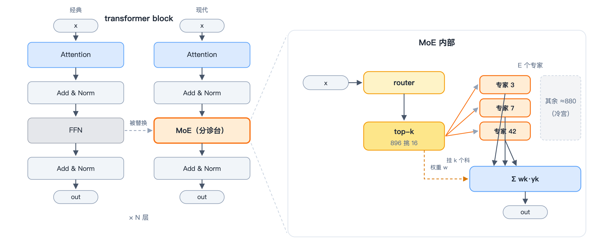

# 第一章｜MoE 是什么，什么又是 Mega-MoE

> **入门主线 · 基础篇 1/3** ｜ [返回目录](../README.md)

## 1.1 先看 MoE 在哪：transformer block 里的"分诊台"

什么是 Mega-MoE？

拆开看，MoE 是 mixture of experts（混合专家），在本教程讨论的模型中，它替换 Transformer block 的前馈网络（FFN）。一个典型 block 包含注意力（attention）和 FFN 两个主要子层，外加归一化、残差连接等结构。原始 Transformer 的 FFN 就是“两次线性变换夹一个非线性激活”，并不是单个线性层；现代模型既有 dense FFN，也有 MoE，不能简单按新旧划分。

为什么要替换 FFN？先看它的参数账：以 Llama 2 70B 的 SwiGLU FFN 为例，hidden=8192、中间维=28672，三张矩阵共有 `3 × 8192 × 28672 ≈ 7.05 亿`参数；80 层约 564 亿，占约 700 亿总参数的八成。只计一次前向的矩阵乘加、一次乘加按 2 FLOP 计，每 token 每层约 1.41 GFLOP，80 层约 112.7 GFLOP。FFN 占全模型计算量的比例还取决于序列长度和 attention 的开销，不能直接从参数占比推出。

在 dense FFN 中，固定 hidden 维、扩大中间维时，参数量和每 token 的 GEMM 计算量会同比增加。MoE 则把一个 FFN 换成多个专家：**总参数随专家总数 E 增长，每个 token 的专家计算主要由选中的 k 个专家决定。** 这让模型能够在相近的活跃计算预算下增加参数容量；路由、通信和访存仍有额外成本，模型质量也需要训练验证。

于是，“怎样增加 FFN 容量”的问题，就多了一种解法：增加专家，同时只让每个 token 调用其中一部分。代价是所有专家权重仍要存储。下一节先算权重和通信的账；第八章讨论如何减少训练激活的保存成本，它并不直接减少专家权重。

MoE 做的事情说来简单——**把 FFN 换成一个"分诊台 + 一排专科医生"**：



*画出来就是这样：左面板看 MoE 在 transformer 里的位置——dense block 的 FFN 被换成专家模块，Attention 原样保留，整个 block 再堆 N 层；右面板把分诊台拆开——router 给每个 token 挑 k 个专科医生（图中只示意三个选中项），其余 E−k 个专家不参与这个 token 的计算，k 个判决按门控权重加权求和出 out。*

- **router** 是一个很小的线性层：`logits = x @ Wr`，对每个 token 算出它对 E 个专家的"亲和度"；
- **top-k 选择**：每个 token 只去 k 个专家（比如 8 个里挑 2 个、896 个里挑 16 个），router 分数经 softmax 或 sigmoid 等变换后用于选择专家，并按模型约定得到**门控权重（gate weight）**。sigmoid 本身不保证权重和为 1；本教程的参考 router 会在选中的 k 项内再归一化。某些专家可能因此收到更多 token，第七章讨论这种负载不均；
- **专家（expert）** 就是一个普普通通的 FFN（通常是 SwiGLU 结构），每个专家有自己的一份权重；
- 最后把 k 个专家的输出按门控权重加权求和，得到这一层的输出。

这里的输入 `x` 是 token 的隐藏状态，不是词表中的整数 token ID。每一行有 hidden_size 个元素。若暂不考虑序列切分，把 batch_size 和 seq_len 展平，记 `S = batch_size × seq_len`，则输入形状为 `[S, hidden_size]`。第二章进入多卡场景后，用 T 表示每个 rank 的 token 数。

再看 mega，它在这里表示把多个操作组合成“大算子”：把 MoE 的通信、访存与计算放进统一调度，争取减少等待、kernel launch 和中间数据搬运。**融合提供了优化机会，实际收益仍要测量。** 下一节先看通信需求从哪里来。

## 1.2 从模型风格的测试形状算起

下面是开源项目实践中使用的三组模型风格测试形状。名称沿用仓库 case 命名，用来说明量级；这些配置本身不能代替对应模型的官方架构说明，尤其不能据此推断完整模型的层数、共享专家或其他分支。

```python
# config/_shapes.py:202-221（摘）
CaseGroup(                       # Qwen 系 MoE
    prefix="performance-fwd-qwen", ...,
    tokens=(4096, 8192, 16384), worlds=(2, 4, 8),
    hidden=2048, ffn=768, topk=8, num_experts=128,
    capacity_factor=1.25,
),
CaseGroup(                       # DeepSeek-V4 风格
    prefix="performance-fwd-dsv4", ...,
    hidden=7168, ffn=3072, topk=6, num_experts=384,
    capacity_factor=4.0,
),
CaseGroup(                       # Kimi-K3
    prefix="performance-fwd-kimi-k3", ...,
    hidden=3584, ffn=3072, topk=16, num_experts=896,
    capacity_factor=1.25,
),
```

拿仓库命名为 Kimi-K3 的这组形状算笔账：896 个专家、每个 token 挑 16 个，该 token 只调用约 1.8% 的专家。**这是逐 token 的稀疏性**；同一批不同 token 可以选择不同专家，所以一次训练迭代仍可能用到全部专家。

只比较专家 GEMM、固定 H 和激活形式，一个中间维为 `k·F` 的 dense SwiGLU FFN 与 k 个中间维为 F 的专家计算量相当。此时 MoE 的总专家参数约为该 dense FFN 的 `E/k = 56` 倍。另一种比较方式是固定总 FFN 参数，此时 MoE 每 token 只计算其中一部分。两种说法采用的比较基准不同，端到端收益还要计入路由、通信和小 GEMM 效率。

继续算权重：取 H=3584、F=3072、E=896，每个专家有三张含 H·F 个元素的矩阵（第二章会拆开），假设专家权重全部以 BF16 存储，每元素 2 字节：

```text
专家参数 = 3 × 3584 × 3072 × 896 = 29,595,009,024
专家权重 = 59,190,018,048 字节 = 55.125 GiB ≈ 59.19 GB
```

这里 `1 GiB = 2³⁰ 字节`，`1 GB = 10⁹ 字节`。若仅作量级演示，假设有 100 个同样的 MoE 层，光专家权重就约 5.38 TiB（5.92 TB）；这不是对实际模型层数的断言，也未计 attention、梯度、优化器状态和激活。

把专家分给多张卡，就是 EP（专家并行）。输入 token 通常也分布在各 rank 上；本地 token 选中的专家可能在远端，因此要把对应隐藏状态发过去，这个过程叫 dispatch，形成 all-to-all 模式的数据交换。专家算完，再把结果送回 token 的来源 rank 并汇总，就是 combine。

集中到一张卡统一分发也可以实现小规模系统，但会集中内存、带宽和调度压力。分布式 dispatch 让各 rank 共同承担收发工作；选择它不意味着任意规模的输入都无法放进单卡。

这笔通信诉求到底有多大？仍取上述形状，EP=8、全局 16384 个 token（每 rank 2048 个），通信中的 token 隐藏状态与专家输出按 BF16 计。下面是**理想均衡条件下的量级估算，不是真机测量**；先忽略路由权重、元数据与协议开销。

**先算通信**：全网有 `16384 × 16 = 262144` 条 token-专家路由，平均每 rank 处理 32768 行。每行 `3584 × 2 = 7168` 字节。dispatch 和 combine 各让每 rank 发送、接收这么多行：

| 统计口径 | 每 rank 数据量 |
|---|---:|
| 一次 dispatch 的发送量（含本地路由） | 224 MiB |
| dispatch + combine 的发送量（含本地路由） | 448 MiB ≈ 0.470 GB |
| 假设 1/8 路由在本地，两个阶段的实际远端发送量 | 392 MiB ≈ 0.411 GB |

接收量在此均衡假设下与发送量相同。若假设每 rank 可用的**单方向有效网络带宽为 200 GB/s，收发可全双工推进**，两个阶段的远端传输时间合计约 `0.411 GB ÷ 200 GB/s = 2.06 ms`；不扣本地路由的粗算为 2.35 ms。不能把收发字节相加后仍除以单方向带宽。真实拓扑、链路争用和到达不均会改变有效带宽与耗时。

**再算计算**：每条路由执行三个专家矩阵乘法，约 `2 × 3 × 3584 × 3072 = 66,060,288 FLOP`；每 rank 合计约 2.165 TFLOP。若假设这些 grouped GEMM 能达到 **300 TFLOP/s 的有效吞吐**，计算约 7.22 ms。这里的有效吞吐是估算假设，不能直接用硬件峰值代替。

在这个简化模型里，通信与计算完全串行约为 `2.06 + 7.22 = 9.28 ms`；理想重叠的下限约为两者的较大值 7.22 ms，实际还要加流水填充、排空及同步等成本。路由倾斜会改变各 rank 的工作量，应看最慢 rank 的关键路径。第三章将沿这笔账讨论怎样安排重叠。

MoE 因而同时提出了三个问题：专家参数怎样分摊，token 怎样找到专家，通信怎样与计算配合。DP、TP、PP 等框架策略与 Mega-MoE 的算子调度分别作用于不同层面，第五章再把它们接起来。

**在计算、通信、显存这一桌并行计算的菜中，Mega-MoE 就是其中一种吃法**。

## 1.3 再看为什么需要"大算子"：三个本质收益

好，重头戏来了。上一节说到，MoE 带来了巨大的通信诉求：本来简简单单做个计算，现在通信这件事掺和进来，也要占用模型运行的时间，颇有一种捉襟见肘、拆东墙补西墙的狼狈感。那 Mega-MoE 凭什么说自己是平衡了显存、计算、通信的一种解法呢？

既然 MoE 层拆开看就是"发数据 + 两个 GEMM + 激活 + 发回来"，用现成的小算子拼不行吗？答案当然可以。这种写法直观，也适合作为基线。大算子希望进一步减少下面三类开销，是否更快取决于具体实现和形状：

**第一笔：减少通信与计算之间的整段等待。** 最直接的小算子实现会先完成整轮 all-to-all，再启动 GEMM；但 dispatch 到齐一块数据，FC1 就有机会先算这一块。多 kernel 配合分块通信、stream 和事件也能实现“边收边算”。**大算子的优势在于把交接进一步细化到 tile，并减少 host 调度与跨 kernel 同步开销。** 真正能否重叠，还取决于通信与计算的执行资源、缓冲安排和带宽竞争。怎么排流水见第三、九章，GPU/NPU 的代表性实现见第六章。

**第二笔：host 侧开销。** 启动 kernel、安排 stream 与事件都需要调度。把多个阶段合进一次或少量 launch，可以减少这些交接；收益占比取决于任务大小、运行时和是否使用图执行等机制，不能给所有模型套一个固定百分比。

**第三笔：减少中间结果的 HBM 往返。** 融合后，部分 tile 可以在片上缓冲中直接交给下一阶段。例如本实现的单 kernel 前向能把 FC1 的部分结果通过 UB 交给激活。远端接收区、跨 program 交接，以及训练反向要保存的数据仍可能驻留 HBM；一次 launch 不等于所有中间量都留在片上。第六章解释具体交接，第八章讨论保存与重算。

## 1.4 后面还有什么：全书导览

本章回答的是"为什么需要 Mega-MoE"；后面八章回答"它长什么样、怎么写、怎么写好"。按阅读动线分三段：

**入门主线（第二、三章）——建议所有读者顺序读完。**

- **第二章《经典结构：从 dispatch 到 combine，从前向到反向》**：把 MoE 层拆成"排序 → dispatch → 两个 grouped GEMM 夹一个 SwiGLU → combine 归约"的一条链，再告诉你反向为什么不是镜像而是一张网——每个 GEMM 裂出 dgrad/wgrad 两个，反向计算量约为前向两倍。读完你会拿到全书通用的形状记号（T、H、F、R_e）和"分桶有序"这个一切优化的前提；
- **第三章《通信与计算掩盖的艺术》**：全书核心。先用"串行分析法"判断通信和计算谁是瓶颈、掩盖的理论下限在哪，再介绍引擎分工、细粒度信号、影子流水和尾部填充，最后结合真代码与阶段打点，理解前向的"边收边算"和反向的段内并行。

**入门提高（第四、五、六章）——知道怎么接、怎么移植。**

- **第四章《通信基础：从对称内存到 Triton custom op》**：先讲对称内存如何寻址、搬运和交接数据，再讲编译器怎样用 custom op 封装通信原语，最后沿着 wait 追到 IR 转换和设备轮询。想动手改 kernel 的读者必看；
- **第五章《和 EP/DP/PP/TP 的关系，以及怎么接进框架》**：EP 按专家分工，与普通参数的 DP/FSDP 等配置衔接；算子怎么从 nn.Module 一路接进 autograd 和宿主框架，算子自己的三本内存账与卸载思想；
- **第六章《NPU 和 GPU：两套硬件，两种掩盖哲学》**：从真实代码看 cv 双缓冲与 GPU worker 分工，按关键路径判断 vv 收益，再看路由布局和 UB 预算。写 CUDA 的读者可以从这章找对照。

**进阶专题（第七、八、九章）——各自独立，按需取用。**

- **第七章《MoonEP：负载均衡为什么值得焊进大算子》**：木桶效应的定量账、副本式均衡（B.0–B.3）、规划/预取/归约全部 device 侧闭环——拆的是 2.2 埋下的那颗雷；
- **第八章《省显存的艺术：从选择性重算到 FC1 重算》**：从保留或卸载 FC1 输出的选择性重算，讲到新分支在反向重算 FC1；结合历史对照，比较保存、搬运和计算的成本。它们降低的是激活保存成本，并不直接消除 1.2 那笔专家权重成本；
- **第九章《前向的全局流水，以及反向的相位制选择》**：前向三级波流水一次 launch 的实现、反向采用相位制的工程取舍，以及 kernel 内相位打点这套“内窥镜”方法。

赶时间的读者可以先看目录中的一句话介绍，再读各章小结和导航。

## 1.5 小结

MoE = 分诊台 + 专科医生，容量与算力解耦；Mega-MoE = 把这一层的通信、访存、计算焊成一条流水线，让三者互相掩盖。**下一章我们把这层拆开，看数据到底怎么流。**

---

← [返回目录](../README.md) ｜ [下一章：经典结构——从 dispatch 到 combine](02-dispatch-to-combine.md) →
