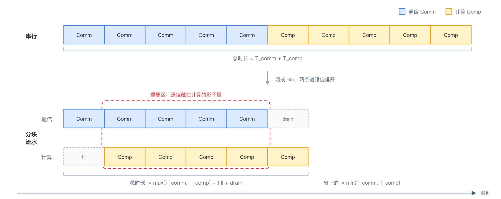
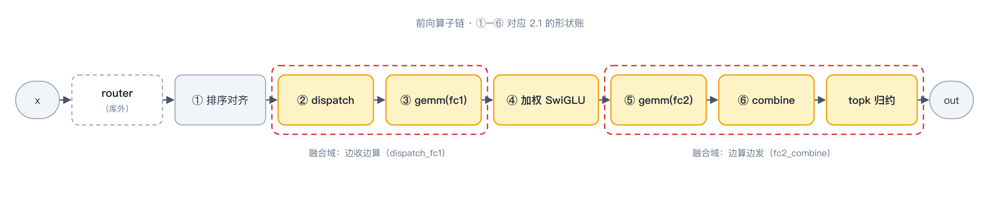
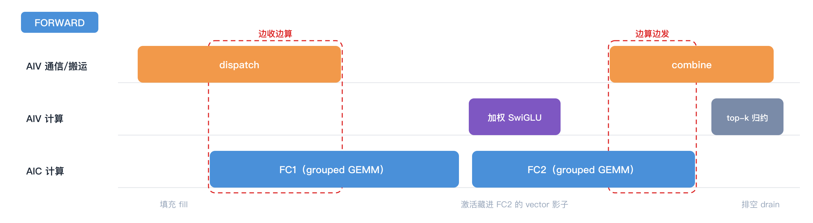
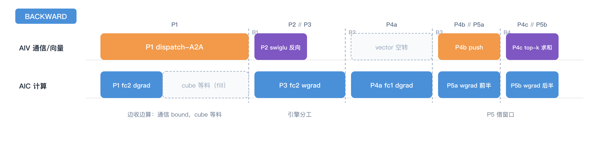

# 第三章｜通信与计算掩盖的艺术

> **入门主线 · 基础篇 3/3** ｜ [返回目录](../README.md)

这一章是全书最核心的一部分。展开的路线是这样的：先从理论出发，拆解两类关键的通算算子——communicate-compute 算子（先收后算）和 compute-communicate 算子（先算后发），并建立分析掩盖流水的基本方法；再拿着这套方法把 MoE 的前向、反向逐段拆解，看每个算子吃什么、吐什么，真代码怎么排；然后把这些做法收拢成一张掩盖手法清单；最后解决一个工程问题：怎么用实测数字证明"掩盖"真的发生了。

## 3.1 到底什么是通信，到底什么是计算

先把两个主角从第一章的账里领出来：**通信**，就是 dispatch 和 combine 那两次 all-to-all——数据从一张卡搬到另一张卡；**计算**，就是 FC1/FC2 两个 GEMM 加中间的激活——在张量上做乘加。Mega-MoE 的通信与计算，账面上就这两样。换个角度看，这俩是典型的生产者-消费者模型：通信生产要算的数据，计算把它消费消化掉。

它们凭什么能重叠？两个前提缺一不可：

- **软件上能分片**：数据能切成 tile 一块一块地走，不用等全量到齐——吃第一块蛋糕的时候，第二块正在送来的路上，两者并行；
- **硬件上执行资源与缓冲允许并发**：通信和计算能由不同引擎或不同 worker 推进，且不会争用到完全串行；缓冲的所有权也要清楚。双 buffer 是常见做法，但不是“必须有两份搬运单元”的硬件定律。

把这两条画成图，就是一切掩盖手法的总模型：



*两条道：上面是通信（Comm），下面是计算（Comp），各切成五块。不重叠时老老实实排两队，总时长是两串之和；分块之后通信填进计算的空隙，只剩开头的填充（fill）和结尾的排空（drain）暴露在外面——红框括住的那段，就是"通信藏在计算影子里"的重叠区。这也是 Mega-MoE 一切掩盖手法的出发点。*

### 四个 token：等哪两行，就能开始算？

回到 [第二章的接收表](02-dispatch-to-combine.md)。只看 rank 1：e2 的 token 0、1 占 offset `[0,2)`，e3 的 token 2、3 占 `[2,4)`。假设 tile 有两行，就把它们叫作 tile A、B。A 到齐，e2 的 FC1 就可以开算；B 不必成为它的前置条件。B 是本地数据，下面“准备 B”包含本地搬运，并非第二次跨卡发送。

```text
相对时段       0          1          2
搬运/发布      准备 A     准备 B
FC1                       计算 A     计算 B
```

这只是表示依赖的示意图，不是实测时长；实际也可能 B 先就绪。若 A、B 各有一个缓冲槽，搬运 B 与计算 A 可以并行；若它们共用一块地址，就必须等 A 的消费者读完才能覆写。e2 的后续激活和 FC2 仍需等待 e2 的 FC1 结果，但无须因此等 e3 的全部工作完成。

这组数据流既可以用多个 kernel 配合事件实现，也可以用大 kernel 内的就绪信号实现。大算子的价值是把调度和交接细化到 tile，同时减少 host 往返；是否真的更快，还取决于同步、访存竞争和 GEMM 效率。

## 3.2 串行分析法：先算清是通信 bound 还是计算 bound

讲手法之前，先把"怎么分析"立起来。MoE 整条链上真正值得融合的，其实是两类"通算算子"：

- **communicate-compute 算子（先收后算）**：dispatch + FC1 是代表——token 从网上收到一块，GEMM 就能算一块。通信是生产者，计算是消费者，掩盖的方向是"边收边算"；
- **compute-communicate 算子（先算后发）**：FC2 + combine 是代表——结果算完一块，就往回发一块。计算是生产者，通信是消费者，掩盖的方向是"边算边发"。

整层 MoE 就是这两类算子首尾相接，中间夹一个纯计算的激活（它最终被塞进 FC2 的影子里，3.5 再讲）；反向同理——P1 是先收后算，P4 是先算后发。

分析任何一个通算算子，用的都是同一套**串行分析法**。讲方法之前，先看一眼理论上限在哪——串行执行时，总时长是两者相加；理想掩盖之后，总时长逼近两者中的大者：

`T_serial = T_comm + T_comp`　→　`T_ideal ≈ max(T_comm, T_comp)`

（严格说还要加上 3.1 图里红框外的那两小截：开头的填充和结尾的排空。）

这个公式值得多读几遍，它有三层含义：

1. **最好的状态，是一个把另一个整个盖住**——T_ideal 里只留下大头的名字，小头全部藏进影子；
2. **掩盖收益的上限是 min(T_comm, T_comp)，两者相等时达到最大**——T_serial − T_ideal = min(T_comm, T_comp)，串行总量不变的前提下，两侧越接近，能省出来的越多；
3. **一侧明显大的时候，先别抠掩盖**——min 被小头卡死，流水排得再细也省不了多少。这时该做的是先优化大头：通信大就降通信量、提带宽，计算大就提算力、减计算，把两侧拉回同一量级，再回来抠掩盖。如此循环，就是本章后面所有手法的总节奏。

落到操作上，串行分析法就三步：

1. **切粒度**：把两边都切到可掩盖的最小单位（一个 128 行的 tile、一段 K 维切片）。粒度越细，可填的缝越多，但同步开销也越大——切多细是个要实测的权衡；
2. **各算理论值**：T_comm = 通信字节数 ÷ 有效带宽，T_comp = FLOP 数 ÷ 实际算力。注意都是"有效"——链路标称 500 GB/s，集合通信能吃满七成就该谢天谢地了；
3. **比大小、定 bound**：T_comm > T_comp 是通信 bound，让计算藏进通信的缝里；反之是计算 bound，让通信藏进计算的影子里。对照上面的上限公式，这一刀下去最多能省多少，心里就有数了。

## 3.3 前向算子拆解：先把最基本的问题问完

好了，上一节讲的是怎么在理论上给通算算子算账，这一节来看实操。

先把最基本的问题答了：**这层到底被切成了哪几个算子？每个吃什么、吐什么？** 多 kernel 路径下，前向 = 一个规划 + 两个大 kernel + 一个收尾 kernel：

```text
build_routing_plan（runtime/routing.py，host 侧规划）
    吃：selected_experts [T,k] + routing_weights [T,k]（router 在库外算好）
    吐：行号表 + 每桶偏移——"谁的第几行、发去哪个桶"（就是 2.3 的对称内存省法）

_kernel_dispatch_fc1（kernels/dispatch_fc1.py:49）
    吃：x [T,H] + 行号表 + W1 [E_r,H,2F]
    吐：fc1_output [ΣR_e, 2F]（接收区按 (源rank, 专家) 桶连续排布）

_kernel_fc2_combine（kernels/fc2_combine.py）
    吃：fc1_output + W2 [E_r,H,F]
    干：加权激活（藏在 FC2 影子里）+ FC2 GEMM + 结果回传 push

_kernel_local_topk_reduce（fc2_combine.py:450）
    吃：回到本 rank 的 k 条行
    吐：out [T,H]（纯求和——加权已在激活处乘掉，见 2.7）
```



*上面这份清单画成图：路由判决 → 排序规划 → dispatch → FC1 → 加权激活 → FC2 → combine → top-k 归约；红虚线圈住的两处（dispatch+FC1、FC2+combine+归约）就是仓库真正焊在一起的融合域——本章接下来讲它们里面长什么样。*

单 kernel 路径（`enable_single_kernel_forward=True`）把这串焊成一次 launch（第九章展开）；反向同理是五个 mega-op（第二章 2.8）。

**第一个精华在 `_kernel_dispatch_fc1`：dispatch 与 FC1 的"边收边算"。** 它在同一个物理 AI Core 上拆出两条指令流——vector 搬 token + 发就绪信号，cube 做分组 GEMM。先看伪代码，全部逻辑就这两段：

```text
vector 侧（搬运工）——对本 rank 要发的每个 tile（128 行）：
    把 tile 从 x 的原位置读出，写进目的 rank 接收区对应的桶
    往"这个 tile 专属的信箱"塞一张到货单（写明第几轮）

cube 侧（计算工）——任务按（专家 × N 维 tile）派给各个 cube 核：
    对每个专家的每个 M 窗口：
        查信箱：算出这个窗口跨哪几个源 rank 的哪几个 tile，只等这几个
        等到就开工：A/B tile 沿 K 维循环乘加（L0A/L0B 喂 cube、L0C 攒结果）
        写出到 fc1_output 对应的桶位——全程不等全量数据到齐
```

再上真实代码对照。先看 vector 搬运工（语法细节第四章逐行拆，这里只需要认出角色）：

```python
# src/mega_moe/kernels/dispatch_fc1.py:406-477（摘）
signal_slot = (
    (LOCAL_RANK * EXPERTS_PER_RANK + expert_id) * MAX_SOURCE_TILES
    + source_tile
)   # ↑ 信箱编号：每个（源rank × 专家 × tile）三元组一个专属信箱，全网不重号
if DIRECT_REMOTE_STORE:
    remote_input_ptr = dl.symm_at(peer_mem_ptr, dst_rank)  # 对端接收区地址（对称堆直接算出）
    ...                                                     # 按 tile 掩码搬数据（第四章）
    libshmem_device.fence()                               # 第一步：建立数据先于通知的顺序（见第四章）
    libshmem_device.signal_op(                            # 第二步：再发到货通知
        signal_mem_ptr + signal_slot * 16,                # 信箱实体：每槽 16 个 int32（ABI 约定，第四章）
        signal_epoch,                                     # 通知内容："第几轮"——单调递增，防上一轮残影
        libshmem_device.ACLSHMEM_SIGNAL_SET,
        dst_rank,
    )
```

再看 cube 计算工——它对同一片接收区做分组 GEMM，核心结构也是三步：派任务、查信箱、齐一块算一块：

```python
# src/mega_moe/kernels/dispatch_fc1.py:614-688（摘）
for task_id in range(pid + first_task, last_task, ncore):  # 任务按（专家 × N 维 tile）派给各 cube 核
    expert_id = task_id // num_n_tiles
    n_tile = task_id % num_n_tiles
    ...
    for m_window in range(0, num_m_windows):               # 该专家的每个 M 窗口
        for source_id in range(0, WORLD_SIZE):             # 窗口跨哪几个源 rank？逐个查
            ...
            if overlap_start < overlap_end:                # 行号有交集的 tile 才需要等
                token = dl.wait(                           # 只等这几个 tile 的届号（acquire 语义）
                    signal_mem_ptr + signal_slot * 16,
                    last_source_tile - first_source_tile + 1,
                    "gpu", "acquire",
                    waitValue=signal_epoch,
                )
                ready_token += token
        ready_input_ptr = dl.consume_token(input_ptr, ready_token)  # 票齐了，接手数据指针
        _triton_grouped_gemm_one_mn_tile_tail(...)         # K 维循环 acc += tl.dot(a, b)，写出到桶位
```

读法就三句：①每发完一个 128 行的 tile，就往它专属的信箱 SET 一个届号；②消费侧（cube 的 GEMM）不等全量，只 `dl.wait` 自己马上要用的那几个 tile；③于是"专家 3 的第 7 个 tile 到齐 → FC1 立刻开算"，不用等专家 11 的数据——**生产者-消费者的细粒度握手，这就是"掩盖"两个字的物理实现。**



*把前向的 kernel 放上三条车道（模块粒度，不画 tile）：dispatch 还没发完 FC1 就开算（红框：边收边算），加权激活整个藏进 FC2 的 vector 影子，FC2 还没算完 combine 已经开始往回发（红框：边算边发），top-k 归约收尾。两头露在外面的填充和排空，就是 3.1 图里红框外的那两小截。第九章的单 kernel 波流水是这张图的"加密版"——同三条车道，模块切得更细、跑得更快。*

## 3.4 反向基本算子的掩盖

把五 op 放到引擎上（`MOE_BWD_MEGA=1` 时融成一个 launch，相位用 kernel 内 barrier 分隔）：



*五相位放上两条引擎车道：P1 是和前向同款的边收边算；P2∥P3 利用 vector 与 cube 分工；P4b∥P5a、P4c∥P5b 把 fc1 wgrad 拆成两半，分别与 push、归约并行；B1–B4 是 kernel 内 barrier，用来发布数据并划分相位。3.5 会区分这些单 launch 内的安排与多 kernel 路径中的尾部填充。*

对照第二章的依赖网看：**当前实现以相位分隔数据发布，在每段内部安排并行工作。** P2/P3 引擎分工、P4b/P5a 借窗口、P4c/P5b 收尾并行。依赖网也能按块流水化，只是需要更细的就绪状态和更复杂的缓冲管理；这里介绍的是已实现的调度选择，第九章再讨论边界。

## 3.5 掩盖手法清单

前面几节先从数据依赖和算子阶段说明了通信、计算如何重叠。这里把实现层面常用的做法归成四招；实际路径会按硬件和调度方式组合使用，不要求每条路径都同时具备四招。

**第一招：异构引擎分工。** GPU 常通过不同 SM/warp 或 copy engine 承担不同工作；昇腾 AI Core 则有 cube（矩阵引擎）和 vector（向量引擎），可以在同一个 kernel 中分别安排 GEMM 与搬运、逐元素操作和通信原语。不同平台的资源组织不同，是否能并发还受资源占用、带宽、缓冲和同步影响；划分角色本身不等于一定加速。

**第二招：用细粒度信号缩小等待范围。** 3.3 的 per-tile SET/wait 就是一个例子。全局 barrier 像"全楼开会等人到齐"；按 tile 发布就绪信号，则让消费者只等自己马上要用的数据。barrier 仍适合阶段间需要全局发布的场景，关键是别让它挡住本可提前开始的工作。

**第三招：影子流水。** 加权 SwiGLU 主要是 vector 工作，FC2 的 GEMM 则主要占用 cube。`_fc2_combine_shadow_activation` 在 FC2 消费较早分组时准备后续分组的激活，让两类工作利用不同引擎并行推进。能否藏住激活，还要看两边的分组、访存和资源占用是否合适。

**第四招：尾部填充。** 多 kernel 反向路径中，combine 最后一组 GEMM 完成后，vector 侧还要继续做剩余 push、同步和 reduce；这时 cube 侧可能已有空档。实现通过 `cube_tail` 回调把 FC1 wgrad 排到 cube stream 尾部，与 vector 的收尾工作并行（`ops/backward.py`、`kernels/combine_fc1_bwd.py`）。这和 `MOE_BWD_MEGA=1` 中把 P5 拆成 P5a/P5b、分别与 P4 阶段并行，是两种不同调度路径；共同点是利用另一类引擎的空闲窗口。

## 3.6 实战笔记：怎么证明"掩盖"真的发生了

光说手法不算数。下面用一次八卡 A3 NPU 反向采集，对照 mega kernel 的融合窗口与分段单独运行时长。它用于观察阶段内的重叠，不是 bigop 与 mega 的端到端对比；测试形状、软件版本、日期和重复次数仍需补录。

表中沿用采集记录的 ms 数值；由 SYS_CNT ticks 换算成 ms 所用的时钟校准值尚未附上。`C` 表示通信段，`K` 表示计算段：C1/K1 对应 dispatch/fc2-dgrad，K23 对应 P2/P3，K4a/C2/K5a 对应 fc1-dgrad/push/fc1-wgrad 前半段，K4c/K5b 对应 top-k reduce/fc1-wgrad 后半段。串行和是分段单独运行时长之和；差额按“串行和 − 融合窗口”估算。

| 融合窗口（SYS_CNT） | 窗口内工作 | 融合时长 | 分段单独运行 | 串行和 | 对照差额 |
|---|---|---:|---|---:|---:|
| **P1**：entry→B1（dispatch‖fc2-dgrad） | C1 + K1 | **5.26** | C1 **1.53** / K1 **4.47** | 6.00 | **0.74** |
| **P2‖P3**：B1→B2（SwiGLU bwd‖fc2-wgrad） | K23，无通信 | **5.63** | **5.59** | 5.59 | **−0.04** |
| **P4**：B2→B4（P4a→B3→push‖P5a） | K4a + C2 + K5a | **11.44** | K4a **6.40** / C2 **4.91** / K5a **5.05** | 16.36 | **4.92** |
| **收尾**：B4→末次时间戳（reduce‖P5b） | K4c + K5b | **1.16**（另估尾排空约 **2.7**，合计约 **3.9**） | K4c **0.96** / K5b **4.68** | 5.64 | **约 1.8** |
| **合计** |  | **23.51**（加尾排空后 kernel 约 **26.2**） |  | **33.57** | **约 7.4** |


> **口径说明**：SYS_CNT 时间戳紧跟引擎 scope 时，记录的是指令发射完成，不一定代表引擎工作已排空；barrier 后的时间戳才覆盖完整的阶段同步。末次时间戳之后仍有约 2.7 ms 的尾排空估值。分段单独运行可能改变调度或编译结果，所以“对照差额”只是重叠量级的估计；收尾估算时长低于 K5b 单独运行值，尤其需要复核。逐行两位小数相加得到融合 **23.49**、分段 **33.59** ms，与合计栏各差 **0.02** ms；合计暂沿用记录值，待原始 ticks 核验。跨运行比较应保留原始 ticks，并核对时钟校准值。

这组数字支持几个有限结论：P1 的分段和为 6.00 ms，融合窗口为 5.26 ms，表观节省约 0.74 ms；这个差额小于 C1 单独运行的 1.53 ms，因此不能说 C1 被完全掩盖。

若用较慢的单段 K1（4.47 ms）作为简化下限，P1 融合窗口仍高约 0.79 ms。这个差值不等同于首个 token 的到达延迟：entry→B1 汇总了多个工作和同步阶段。源码还记录了 entry、dispatch 发出、cube sweep 完成和 B1 之后等时间点；要定位差值来源，需要结合这些分段的原始 ticks 与时钟校准值分析。SIMT 可以作为待验证的探索方向，但当前这组数据没有测试它是否能减少暴露时间。

P4 的差额约 4.92 ms，接近 C2 单独运行的 4.91 ms，符合 push 与 P5a 大幅重叠的预期，但单凭差额不能证明 C2 全部被隐藏。

合计的约 7.4 ms 是分段单独运行总和与加上尾排空估值后的 kernel 时长之间的差，不等同于端到端加速，也不能直接与另一组 bigop 对比相减。要判断通信是否是剩余瓶颈，应在同一测试配置下同时记录原始 SYS_CNT ticks、kernel event 时长和重复采样，再按 3.2 的串行分析法比较通信与计算。

## 3.7 小结

先用串行分析法判断通信和计算谁更慢、理想情况下能隐藏多少，再通过引擎分工、细粒度信号、影子流水和尾部填充填补空闲窗口。前向典型做法是边收边算，反向则在相位或流水尾段安排并行工作。3.6 的 SYS_CNT 表展示了怎样用测量检查重叠，同时也说明分段差额只是近似证据，测试边界和尾排空都要交代清楚。**核里两类指令流如何交接、跨 rank 的数据如何通知？下一章拆通信原语 signal / wait / epoch；第六章再比较 NPU 和 GPU 的硬件组织。**

---

← [上一章](02-dispatch-to-combine.md) ｜ [返回目录](../README.md) ｜ [下一章：通信原语](04-comm-primitives.md) →
