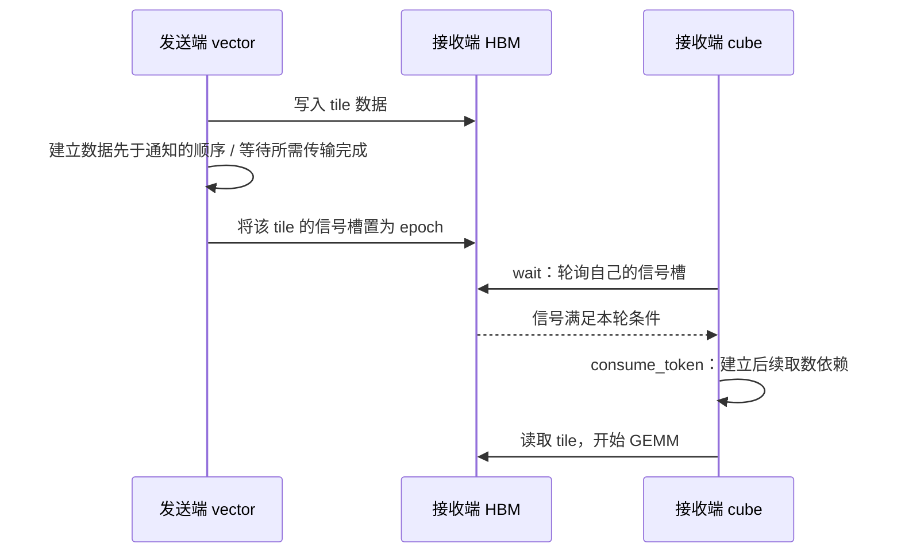
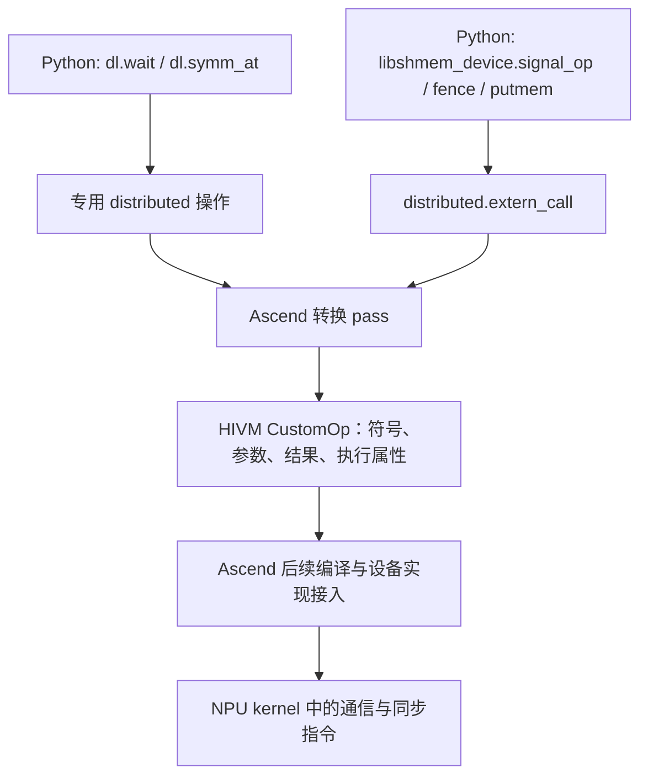

# 第四章｜通信基础：从对称内存到 Triton custom op

> **入门主线 · 提高篇** ｜ [返回目录](../README.md)

第三章里，vector 把一个 tile 发出去，cube 等到就绪信号就开始 GEMM。我们已经知道这样排能把通信和计算叠起来，但还有两个问题没有回答：**一张卡怎么把数据写到另一张卡？Triton 又怎么把“发送、通知、等待”这些操作编译进同一个 kernel？**

这一章先讲通信的运行机制：对称内存怎样提供远端地址，数据怎样搬过去，收端怎样知道可以读。后半章再看编译器如何把通信原语封装成 custom op，最后沿着 `dl.wait` 从 Python 一直追到设备端的等待行为。普通读者看懂数据流即可；想扩展原语的读者，可以沿源码入口继续往下读。

本章使用两个相邻仓库：算子实例来自 `Mega-MoE-TD`，编译器实现来自 `Triton-distributed-ascend`。下文以 **TD** 简称后者。引用以文件和函数名为准；标为“示意”的代码省略了初始化、任务分配或后端细节，不是可直接启动的完整程序。

## 4.1 对称内存：先让双方知道“写到哪里”

先想一个最小场景：rank 0 有一行 token，要把它交给 rank 1 上的专家。rank 0 至少需要知道三件事：目的 rank 是谁、目的缓冲区是哪块、这一行落在缓冲区的哪个位置。

在普通进程模型里，rank 0 手上的本地指针只解释本进程的地址。把这个整数直接交给另一张卡，不能自动指向那张卡的对应对象。SHMEM 用**对称分配**来建立这种对应关系：参加通信的 PE（Processing Element，这里可理解为 rank）以一致的顺序、尺寸和对齐要求分配对象，每个 rank 都在自己的对称堆里得到一份对应的缓冲区。

```text
rank 0 的 HBM / 对称堆             rank 1 的 HBM / 对称堆
base_0                            base_1
  + offset_x    peer_mem            + offset_x    peer_mem
  + offset_w    routing_weight_mem  + offset_w    routing_weight_mem
  + offset_s    signal_mem          + offset_s    signal_mem
```

**“对称”指对象布局可以对应，各 rank 仍然各有一份物理内存。** 相应缓冲区里的内容可以完全不同。也不应把“各进程指针整数必须相同”当作使用前提；关键是运行时能把“本地对称对象 + 目标 rank”解析成目标对象。

对支持直接映射的路径，可以把地址转换理解成下面的字节地址公式：

```text
对象在堆内的偏移 = 本地对象地址 − 本地堆基址
可访问的对端对象地址 = 本进程可见的对端堆映射基址 + 对象在堆内的偏移
```

初始化时，通信运行时建立参与者信息、内存注册以及传输路径需要的映射或连接。之后 `dl.symm_at(ptr, peer)` 就能表达“取 peer 上与 ptr 对应的地址”。它负责地址转换；执行后面的 load/store 或 put/get 时，数据才真正经过互连。

## 4.2 有了远端地址，数据是怎么过去的？

对称内存给出统一的寻址方式，实际搬运仍然由硬件和通信库完成。读 Mega-MoE 的 dispatch，主要会遇到两种写法：

| 写法 | kernel 里表达什么 | 谁处理远端地址和传输 |
|---|---|---|
| `remote = dl.symm_at(local_symm, peer)`，随后 `tl.store(remote + offset, data)` | 向已经映射的对端地址写数据 | 运行时提供映射，后端生成访存指令，互连完成传输 |
| `libshmem_device.putmem(local_symm + offset, src, nbytes, peer)` | 把本地数据送到 peer 的对应对称对象 | SHMEM 解释目标对象和 rank，并通过选定引擎搬运 |

第二种写法里的目标参数仍是**本地对称对象对应位置的指针**，由 `peer` 指定真正的目的地。不要先转成远端映射指针，再不加判断地传给要求本地对称指针的 API。读方向类似：直接可访问的地址可以 load，库接口则用 get 表达远程读取。

可以把 put 理解为单边通信：发送端拿到目标对象和偏移后就能发起写入，接收端无须为每一块数据配对调用一次 recv。但接收缓冲区必须已经分配好，双方必须约定布局，还必须处理数据可见性和生命周期。

跨节点或不支持直接映射的拓扑，需要库提供相应的远程传输路径，不能把任意远端地址都当成本地指针访问。TD 的 Ascend 路径使用 ACLSHMEM，具体可能走 MTE、UDMA 等引擎。**kernel 里的接口相似，不代表底层都是一次普通 store。**

### 对称地址之外，还需要路由布局

继续使用第二章的四个 token：rank 1 的 e2 接收 token 0、1，占接收行 `[0,2)`；e3 接收 token 2、3，占 `[2,4)`。rank 0 要给 e2 发数据，需要先知道 e2 在 rank 1 上的起始行是 0。

这个行号来自路由规划。对称内存不会自动推导每个专家收到多少 token，也不会消除计数交换。Mega-MoE 把计数发布到对称内存，再用双方一致的规则算桶偏移；有了这些元数据，才可以从原始输入直接 gather 到对端目标位置。

```python
# 直接映射路径的示意，offsets 为元素偏移；实际代码还要处理 mask。
remote_input = dl.symm_at(peer_mem_ptr, dst_rank)
values = tl.load(input_ptr + source_offsets)
tl.store(remote_input + destination_offsets, values)
```

这里 `symm_at` 解决“哪张卡的哪块对象”，`destination_offsets` 解决“对象中的哪几行”。这两层一起，才构成 dispatch 的目标地址。

## 4.3 数据写出以后，为什么还要 signal / wait？

发送端发出了写操作，不等于接收端此刻就可以读完整个 tile。数据搬运、标量信号访问和 GEMM 的取数可能经过不同流水线；缓存也可能保留旧内容。因此，需要一份明确的交接协议：



Mega-MoE 的 [`dispatch_fc1.py::_dispatch_one_source_tile_task`](../../Mega-MoE-TD/src/mega_moe/kernels/dispatch_fc1.py) 中，可以看到两条实际路径（按结构摘写）：

```python
# 直接远端 store 路径
# 先写完 tile 数据和 routing weights。
tl.store(remote_input_ptr + offsets, values, mask=mask)
# ... routing weights 的 store ...
libshmem_device.fence()
libshmem_device.signal_op(
    signal_mem_ptr + signal_slot * 16,
    signal_epoch,
    libshmem_device.ACLSHMEM_SIGNAL_SET,
    dst_rank,
)

# putmem 路径
# 先发完该 tile 的数据和 routing weights。
libshmem_device.putmem(dst_symm_ptr, src_ptr, nbytes, dst_rank)
# ... 其余行及 routing weights 的 putmem ...
libshmem_device.quiet()
libshmem_device.signal_op(
    signal_mem_ptr + signal_slot * 16,
    signal_epoch,
    libshmem_device.ACLSHMEM_SIGNAL_SET,
    dst_rank,
)
```

`fence` 侧重建立操作顺序，`quiet` 侧重等待其作用范围内的已发起通信完成。两者的具体保证取决于后端、传输引擎和 API 契约；上面是仓库的两条实现路径，不能把任意异步传输都套成一句 `fence()` 就认为已经完成。

接收端则先等信号，再沿等待结果建立数据依赖：

```python
token = dl.wait(
    signal_mem_ptr + signal_slot * 16,
    1, "gpu", "acquire", waitValue=signal_epoch,
)
ready_input_ptr = dl.consume_token(input_ptr, token)
values = tl.load(ready_input_ptr + offsets, mask=mask)
```

这包含两种顺序：运行时必须保证“数据先发布、信号后可见”，编译器必须保证“等待之后才进行依赖它的数据访问”。`consume_token` 把后者显式写进 IR；它不会替发送端完成尚未正确排序的传输。

## 4.4 一个 tile 对应哪个信号槽？epoch 又解决什么？

信号槽必须与被保护的数据对应。第三章的 dispatch 按 `(来源 rank, 本地专家, 来源 tile)` 编号：

```python
signal_slot = (
    (source_rank * experts_per_rank + local_expert_id) * max_source_tiles
    + source_tile
)
```

注意 `local_expert_id` 是目的 rank 内的专家编号。四个 token 的例子中，rank 1 上的 e2、e3 分别是本地专家 0、1。若教学示例令每个来源桶只预留一个 tile，即 `max_source_tiles=1`，信号对应关系是：

| rank 1 的数据 | 来源 rank | 本地专家编号 | 槽号 | `int32` 信号地址 |
|---|---:|---:|---:|---|
| tile A：token 0、1 → e2 | 0 | 0 | 0 | `signal_ptr + 0 * 16` |
| tile B：token 2、3 → e3 | 1 | 1 | 3 | `signal_ptr + 3 * 16` |

槽 1、2 对应这次路由里的空桶，消费者不应无条件等待它们。tile B 是本地搬运，也可以用同样的就绪协议交给计算侧。

这里一个信号槽占 **64 字节**：`int32` 指针下是 16 个元素。TD 的 Ascend wait 接口测试明确记录，多个 barrier 按 64 字节步长遍历；若信号类型是 `int64`，元素步长就是 8。`numBarriers=2` 表示等相邻两个**槽**，不是等紧挨着的两个 `int32`。因此，上表的 A、B 不能简单合成从槽 0 开始、数量为 2 的等待。

如果每轮都写 `1`，第二轮开始时上一轮留下的 `1` 会让消费者提前通过。Mega-MoE 采用递增的 epoch（轮次号）：第 7 轮发布 7，第 8 轮等待 8。旧的 7 不能被当作第 8 轮已到货。

epoch 解决的是**通知属于哪一轮**。缓冲区何时可覆写，还需要所有权协议保证：上一轮消费者没读完，下一轮不能抢先覆盖同一块数据；必要时用双缓冲、确认信号或阶段同步。工程上还要约束信号类型的取值范围，并在安全的全局静止点处理回绕。仅让计数一直增长，不能支持无限轮次或任意多个请求同时在飞。

## 4.5 host 先搭好通信环境，device 再推进数据流

上面的几行 kernel 代码有一套 host 前提。ACLSHMEM 先初始化参与者、堆容量和传输引擎，各 rank 再按约定分配数据、权重和信号对象。以 [`create_moe_forward_context`](../../Mega-MoE-TD/src/mega_moe/runtime/workspace.py) 为例，分配顺序是 `peer_mem`、`routing_weight_mem`、`signal_mem`，后面还有规划使用的元数据对象。

```python
# 分配部分的结构示意；所有 rank 必须使用对应的尺寸和顺序。
peer_mem = ash.aclshmem_create_tensor(
    [max_received_routes * hidden_size], dtype=torch.bfloat16, device_id=dev,
)
# ... 同序分配 routing_weight_mem ...
signal_mem = ash.aclshmem_create_tensor(
    [signal_slots * 16], dtype=torch.int32, device_id=dev,
)
signal_mem.zero_()
# 初始化写入完成、所有参与者准备好之后，才能启动生产者和消费者。
```

信号清零也要纳入同步：如果生产者已经发出通知，接收端尚未完成的清零可能把通知擦掉。TD 的 `test_wait_notify.py` 中，SET/ADD 用例在清零后先做设备同步，再做 rank 间 barrier，之后才启动收发。

Mega-MoE 的接口还对 `peer_mem` 保留了“会话第一个对称分配、heap offset 0”的要求，见 `ops/function.py` 的 `MegaMoEFunction` 文档。这是该算子与其所依赖实现的接入契约；**对称内存模型本身允许多个对象对应不同的堆偏移**，不能把这个要求推广为所有 SHMEM 指针转换只能处理 offset 0。

同理，context 和 epoch 状态要跨迭代复用；释放或复用缓冲区之前，要确保没有仍在访问它的通信与计算。host 负责建立这些长期约定，device 才能在一次 kernel 内连续执行许多次细粒度交接。

## 4.6 对称接收区有多大：capacity 是一笔 HBM 预算

对称分配的尺寸必须一致，但实际接收行数会随路由倾斜变化。设每个 rank 最多有 `T` 个输入 token、top-k 为 `k`、EP 大小为 `W`。若各 rank 都有 `T` 个 token，平均每 rank 接收 `T·k` 条路由，保守上界则是全世界的 `W·T·k` 条路由都落到一个 rank。

Mega-MoE 在 `runtime/workspace.py` 中用下面的公式分配接收行数：

```python
max_received_routes = math.ceil(
    max_tokens_per_rank * top_k * receive_capacity_factor
)
```

BF16 token 接收区的字节数就是 `ceil(T·k·cf) × H × 2`。例如 `T=2048, k=8, H=7168, W=8`：

| cf | 每 rank 接收区 | 预算含义 |
|---:|---:|---|
| 1.0 | 224 MiB | 按平均接收量分配，需要负载约束支持 |
| 1.6875 | 378 MiB | 覆盖这个指定倾斜倍数 |
| 8.0 | 1.75 GiB | 覆盖上述全路由集中到一个 rank 的保守上界 |

这只是 `peer_mem`，还不包含 routing weights、信号、元数据和反向 workspace。各 rank 都要分配同尺寸的对称对象，因此很热的一个 rank 会抬高所有 rank 的预留预算。

本章依据的 `release_v4` 中，`config.py::resolved_receive_capacity_factor` 对普通 EP 默认返回 `W`；开启 MoonEP 时默认返回 `2.0`，还考虑了反向 wgrad 的 padding 空间。不能只凭前向均衡到 `T·k`，就推断整套训练 workspace 的默认 cf 应该是 1。新主线 improved-v2 的容量变化见第七章 7.5。

这里的 cf 控制接收区容量，dropless 路径不会把超额路由静默丢掉。分阶段 host 路径在 `runtime/routing.py::build_routing_plan` 中检查实际所需容量，不足就报错；单 kernel 路径还需要自己的容量检查。减少 cf 之前，既要看路由负载，也要看整个前反向实现的空间需求。

## 4.7 编译器怎样把通信原语接进 Triton？

现在已经知道运行时需要干什么，再看编译器怎样表达它。普通 Triton 擅长描述张量上的 load、store、dot 等操作；SHMEM 原语还涉及远端寻址、通信引擎和同步。TD 为这些能力增加 Python 接口和 MLIR 操作，再把操作转换为目标后端能处理的形式。

这里的 **custom op 是编译器 IR 里的扩展操作**。本章讨论的是 Ascend 后端的 `hivm::CustomOp`；它在 IR 文本中可打印为 `hir.custom`。它最终属于设备 kernel 的执行内容，并非每到一次 wait 都返回 Python 再启动另一个算子。



### 两种前端入口，汇入同一条 Ascend 转换路径

**第一种是有专门语义的操作。** `dl.wait`、`dl.consume_token`、`dl.symm_at` 等在 `python/triton_dist/language/distributed_ops.py` 中定义。Python 编译前端通过 builder 创建 `distributed.wait`、`distributed.consume_token` 等 IR 节点；节点的操作数、结果类型和属性在 `DistributedOps.td` 中定义。

**第二种是外部设备函数调用。** `libshmem_device.signal_op` 等函数通过 `extern_call` 描述参数类型、目标符号、返回值以及是否有副作用。例如 Ascend 的 `signal_op` 会选中 `aclshmemx_signal_op`，传入信号指针、值、SET/ADD 操作和目标 PE，并设置 `is_pure=False`。`language/core.py::extern_call` 将它变成 `distributed.extern_call`。

两种入口最后都经过 `ConvertTritonDistributedToHIVM`。核心改写逻辑在 [`DistributedOpToHIVM.cpp`](../../Triton-distributed-ascend/lib/Conversion/TritonDistributedToHIVM/ASCEND/DistributedOpToHIVM.cpp) 的 `matchAndRewrite` 中：

1. **选设备符号。** 对 `wait`，按信号元素类型生成 `aclshmem_wait_int32` 等名称；对 extern call，使用已经指定的符号。
2. **接好参数和结果。** 创建 `hivm::CustomOp`，把原操作的参数与返回值接过去；必要时按 ABI 转换参数，比如 `notify` 的信号类型和 SET/ADD 编号。
3. **带上后端需要的执行信息。** 包括执行核类型、pipe、副作用信息以及 `hivm.is_distributed` 标记，再用新节点替换原节点。

创建节点的关键代码如下（省略参数准备和后续属性处理）：

```cpp
std::string customName = customPrefix + "." + symbolName;
auto customOp =
    rewriter.create<hivm::CustomOp>(loc, op->getResultTypes(), customName,
                                   operands, customResults, ValueRange{});
customOp->setAttrs(op->getAttrs());
customOp->setAttr("hivm.is_distributed", rewriter.getUnitAttr());
// ... 设置 pipe、symbol、核类型及其他属性 ...
```

这里 `customPrefix` 是注册转换规则时传入的 `"dist"`，`op->getResultTypes()` 保留返回值类型，`operands` 连接输入。对带结果的 wait，后面通过 `rewriter.replaceOp(op, customOp)` 把原 token 的使用者接到新节点；这样下一步的 `consume_token` 仍然依赖这次等待。

### “黑盒”也必须告诉编译器哪些事？

custom op 允许编译器不在这一层展开通信库内部的每条指令，但接口必须说明足够多的约束。否则优化器可能删除一次通知、提前执行一次读，或把操作安排到不支持它的核上。

| 信息 | 当前源码中的表达 | 作用 |
|---|---|---|
| 调哪个设备入口 | `symbol`，以及 `dist.<symbol>` 自定义名称 | 把原语对应到设备实现 |
| 输入与输出 | operands、result types | 检查类型并保留数据依赖 |
| 是否访问内存 | `MemoryEffectsOpInterface`；无副作用时才标 `no_side_effect` | 约束删除、移动和推测执行等优化 |
| 由哪类核执行 | extern 包装的 `distributed.core_type`，随后转换为 HIVM 属性 | 表达 vector、cube 等执行要求 |
| 使用哪条流水线 | `pipeMap` 查询；未匹配时设为 `PIPE_S` | 提供后端调度与同步所需信息 |
| 哪些参数是入口 GM 指针 | `gm_addr_args_indices` | 标记直接来自 kernel 形参的标量指针；并非所有指针表达式都会入表 |

这里的“副作用”是编译器概念：比如信号更新会影响后续程序的观察结果，不能被当成只计算一个数的纯函数。当前 `WaitOp` 声明内存读，非纯 `ExternCallOp` 声明内存读写；`ConsumeTokenOp` 则通过操作数和结果表达依赖，自身没有内存副作用。

后续 Ascend 编译还要识别自定义符号并接入相应设备实现，才能生成可执行 kernel。因此，新增通信原语通常需要同时打通 **Python 包装、IR/转换规则、设备实现及 ABI**。仅给 custom op 起个名字，通信不会自动发生。

## 4.8 具体追一遍：`dl.wait` 是怎么实现的？

先固定一个调用：接收区和信号区都已准备好，消费者等一个 `int32` 信号槽，目标是第 7 轮。

```python
token = dl.wait(signal_ptr, 1, "gpu", "acquire", waitValue=7)
ready_ptr = dl.consume_token(recv_ptr, token)
x = tl.load(ready_ptr + offsets)
```

### 第一步：Python 接口在编译时生成 WaitOp

`distributed_ops.py::wait` 检查传入值是不是指针，把 `waitValue` 转成与信号元素类型匹配的整数 IR 值，并解析 scope 与 semantic。随后调用：

```python
# TD: python/triton_dist/language/distributed_ops.py，wait（摘）
_semantic.builder.create_distributed_wait(
    barrierPtrs.handle,
    _semantic.to_tensor(numBarriers).handle,
    waitValue,
    scope,
    semantic,
    tlc.int32.to_ir(_semantic.builder),
)
```

`python/src/ir.cc` 中的绑定再调用 `self.create<...::WaitOp>(...)`。这个 Python 函数此时是在**生成 IR**，没有在 host 上轮询 NPU 内存。返回的 `token` 对应一个 `int32` 的 IR 结果。

### 第二步：IR 保留等待与取数的关系

`include/TritonDistributed/Dialect/Distributed/IR/DistributedOps.td` 定义了 `TT_WaitOp`。它的主要输入是 `barrierPtr`、`numBarriers`、`waitValue`，属性包含 `scope` 和 `semantic`，输出是 `token`。以 `int32` 信号和 FP32 数据指针为例，关键 IR 可以写成：

```mlir
// 示意：省略函数声明及常量定义。
%token = distributed.wait %signal, %one, %epoch,
    scope = gpu semantic = acquire : !tt.ptr<i32>, i32, i32 -> i32
%ready = distributed.consume_token %recv, %token,
    : !tt.ptr<f32>, i32 -> !tt.ptr<f32>
// 后续 load 使用 %ready 派生的地址。
```

依赖链是 `wait → token → consume_token → ready pointer → load`。`token` 的用途是承载这条依赖；不要把它当作信号槽的值，也不要假设它的具体数值等于 epoch。`consume_token` 保持原值的类型，并让后续使用依赖等待完成；对指针而言，业务上仍指向原来那份数据。

### 第三步：Ascend 将 WaitOp 改写成 custom op

`DistributedOpToHIVM.cpp` 中的分支直接决定符号：

```cpp
// 按源码逻辑简写：从 barrierPtr 的 pointee type 得到类型名。
symbolName = "aclshmem_wait_" + typeName;
```

于是 `!tt.ptr<i32>` 选择 `aclshmem_wait_int32`，自定义名称是 `dist.aclshmem_wait_int32`。三个操作数仍然是信号指针、信号槽数量和目标值，结果仍是 token。`scope`、`semantic` 作为原操作属性随改写保留；这个转换 pass 本身并未把 `acquire` 展开成某一条硬件指令，最终内存序要由后续编译与设备实现共同兑现。

同样，上例的 `consume_token` 会选择 `aclshmem_consume_token_float_ptr_1d`。这两个符号及其 GM 参数标记，在 TD 的 `python/triton_dist/test/ascend/api/test_gm_addr_args_indices.py` 中有 IR 转换测试。

源码中的 `"gpu"` 是沿用 Triton 的 memory scope 名称，在这里并不意味着执行目标变成了 NVIDIA GPU。也不要仅通过改成 `"sys"`，就推断某个传输引擎已经具备跨节点的全部可见性保证。

### 第四步：设备端刷新信号读取，循环检查条件

到运行时，等待是在设备上推进的。TD 的 [`triton_dist_semantics.rst`](../../Triton-distributed-ascend/docs_ascend/zh/api/triton_dist_semantics.rst)“通信原语的运行时实现”部分给出了底层等待谓词的典型形态。以相等比较为例：

```cpp
// 据仓库文档摘录的底层 EQ 等待谓词形态，非完整 dl.wait wrapper。
do {
    dcci_cacheline((__gm__ uint8_t *)sig_addr);
} while (*sig_addr != cmp_val);
```

它先执行缓存行维护，再读取信号，条件不满足就继续循环。目的是让轮询能够观察到其他执行单元或 rank 更新的信号，避免一直命中旧的缓存内容。该文档将 `dcci_cacheline` 描述为封装 `DataCacheCleanAndInvalid`，并使用编译器屏障约束优化。

`dl.wait(ptr, n, ...)` 还要按 wrapper 的 ABI 遍历 `n` 个信号槽；当前 Ascend API 测试记录的步长是 64 字节。理解其控制流时，可以写成下面的**机制伪代码**：

```text
for i in 0 .. numBarriers-1:
    slot = barrierPtr 的字节地址 + i * 64
    循环：维护 slot 的缓存行，重新读取，直到满足目标等待条件
产生供 consume_token 使用的 token
```

这份本地 checkout 的 `3rdparty/triton-ascend` 与 `3rdparty/shmem` 子模块尚未展开。因此，本节能直接核对到的是 **WaitOp → custom op 的转换源码**、**64 字节步长的 API 测试约定**，以及仓库文档给出的**底层轮询机制**。上面的 EQ 循环不是 `aclshmem_wait_int32` wrapper 的逐行源码，也不能据此把所有后端的 `dl.wait` 都断言为相同的比较谓词。需要确认具体版本的谓词、token 返回值和完整 acquire 实现时，应继续查看对应子模块与工具链。

这已经足够解释三个实际现象：等待占用设备执行资源；等待本身不负责搬运 payload；这种轮询不清除信号，多个消费者可以等同一轮通知，但生产者仍必须等所有相关消费者读完才能复用数据。

## 4.9 把整条链放回四个 token

最后回到 rank 0 给 rank 1 的 e2 发送 tile A。为了看清机制，只保留消费者会读到的两行 token、一个发送者、一个信号槽。以下是 kernel 内部片段，假设 host 已完成对称分配和初始化同步，路由规划也已给出目的位置：

```python
# 发送端 rank 0：tile A 的 source/destination offsets 已由路由确定。
remote = dl.symm_at(peer_mem_ptr, 1)
data = tl.load(input_ptr + source_offsets, mask=mask, other=0)
tl.store(remote + destination_offsets, data, mask=mask)
# 完整 MoE 还要先发送该 tile 的 routing weights。
libshmem_device.fence()
libshmem_device.signal_op(
    signal_ptr + 0 * 16, epoch,
    libshmem_device.ACLSHMEM_SIGNAL_SET, 1,
)

# 接收端 rank 1：signal_ptr 和 peer_mem_ptr 是本 rank 的本地对象。
token = dl.wait(signal_ptr + 0 * 16, 1, "gpu", "acquire", waitValue=epoch)
ready = dl.consume_token(peer_mem_ptr, token)
tile_a = tl.load(ready + destination_offsets, mask=mask, other=0)
# 随后用 tile_a 参与 e2 的 GEMM；无须等待 e3 的 tile B。
```

沿这段代码向下看，每层只承担一部分工作：对称分配建立对象对应关系，路由规划给出行偏移，远端 store 搬运数据，发布顺序和信号告诉接收端何时可以接手；编译器则把这些原语变成带类型、依赖与执行约束的 custom op，交由设备实现执行。第三章的一句“到一块、算一块”，就是靠这些约定逐层落实的。

想继续对照代码，可以按下面的顺序读：

| 要追的问题 | 源码入口 |
|---|---|
| 对称区和信号区怎样分配 | Mega-MoE-TD：`src/mega_moe/runtime/workspace.py::create_moe_forward_context` |
| tile 怎样发出、怎样等齐 | Mega-MoE-TD：`src/mega_moe/kernels/dispatch_fc1.py` |
| Python 原语怎样生成 IR | TD：`python/triton_dist/language/distributed_ops.py`、`python/src/ir.cc` |
| 原语怎样声明类型和副作用 | TD：`include/TritonDistributed/Dialect/Distributed/IR/DistributedOps.td`、`lib/Dialect/Distributed/IR/Ops.cpp` |
| 库接口怎样包装 extern call | TD：`python/triton_dist/language/extra/ascend/libaclshmem_device.py`、`python/triton_dist/language/core.py` |
| custom op 怎样生成 | TD：`lib/Conversion/TritonDistributedToHIVM/ASCEND/DistributedOpToHIVM.cpp` |
| 怎样验证转换与设备行为 | TD：`python/triton_dist/test/ascend/api/test_gm_addr_args_indices.py`、`python/triton_dist/test/ascend/api/test_wait_notify.py` |

[CPU 小实验](../examples/README.md) 可以核对这里的 token 和接收行布局；它不模拟缓存、设备内存序或真实通信。验证 wait/notify 的硬件行为需要相应的 Ascend 编译环境和多卡测试。

---

← [上一章：通信与计算掩盖](03-mega-moe-td-walkthrough.md) ｜ [返回目录](../README.md) ｜ [下一章：框架接入](05-ep-and-framework.md) →
