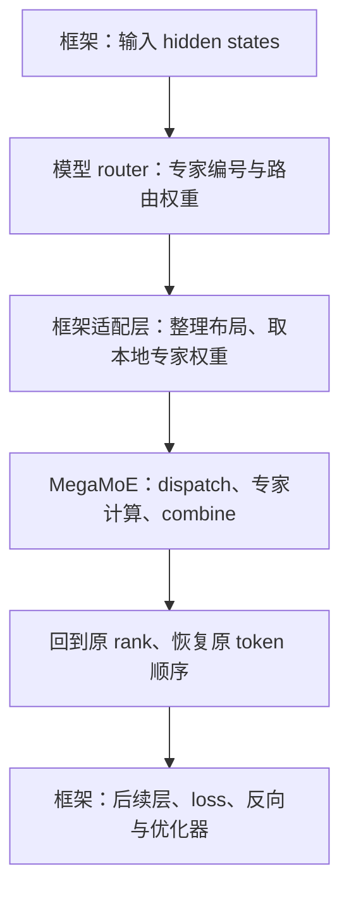

# 第五章｜和 EP/DP/PP/TP 的关系，以及怎么接进框架

> **入门主线 · 提高篇 2/3** ｜ [返回目录](../README.md)

**一句话：框架决定参数怎么分、数据怎么分、梯度怎么同步；MegaMoE 接过路由结果，完成 EP 内部的通信与专家计算。DP 可以在框架层配置，两者通过明确的参数归属和接口接在一起。**

前三章讲了 MoE 怎样算，第四章讲了通信原语怎样支撑它。这一章把视角往上移一层：一个能独立跑通前反向的大算子，怎样进入完整的训练过程？

沿用前面的主线，我们先看 EP 与其他并行方式的关系，再看 PyTorch 和宿主框架怎样调用它，最后看算子自己的内存由谁管理。本章根据开源项目实践，分别介绍宿主框架与融合算子的职责；接口和限制以文中展示的实现为准。

## 5.1 EP 多出来的，是“按专家分工”

一个 Transformer 层里，不同部分可以采用不同的分工方式。先把几个缩写各自回答的问题摆出来：

| 并行方式 | 分的是什么 | 放到 MoE 训练里怎样理解 |
|---|---|---|
| DP：数据并行 | 输入数据；各副本计算后同步同一参数的梯度 | 不同 rank 处理不同样本，普通参数可以复制，也可以配合 FSDP 分片 |
| TP：张量并行 | 一个算子的权重和计算维度 | 比如把一个线性层的矩阵乘法分给多张卡 |
| PP：流水线并行 | 模型的层 | 不同 stage 负责不同层，传递 microbatch 的激活与梯度 |
| SP/CP：序列或上下文并行 | 序列维上的激活与计算 | 具体通信方式取决于实现，不能统一当成另一种参数切分 |
| EP：专家并行 | 不同专家 | 每张卡持有一部分专家，token 按路由结果找到对应专家 |

例如 896 个专家做 EP=8，每张卡持有 112 个专家。与 TP 把一个专家的矩阵继续切开相比，EP 的基本分工是“你算这些专家，我算那些专家”。普通 EP 下，同一专家的 gate/up/down 权重都在它的归属 rank 上。

```text
同一组设备上的一个 Transformer 层
    attention、router 等普通模块：由框架安排 DP/FSDP、TP 等
    routed experts：按专家切分，用 EP 执行 dispatch → 专家计算 → combine

沿模型深度还可以考虑 PP；跨模块的张量布局与调度由框架衔接。
```

这里说“可以组合”，指的是这些分工解决不同问题。**它们不一定是同一张网格上可以直接相乘的独立维度。** 普通参数和专家参数可能使用两套网格；具体实现也未必支持每一种组合。后面会看到，同样 8 张卡，普通参数可以做 FSDP=8，专家参数同时做 EP=8，并不需要 64 张卡。

EP 也不是“通信天然更少”。一次前向中，dispatch 和 combine 是两次逻辑上的 all-to-all 数据交换，数据量大致随 token 数、hidden size 和 top-k 增长；MegaMoE 用设备侧搬运实现它们，不一定调用两个 host collective。TP 则常有 all-reduce 或 reduce-scatter/all-gather，次数取决于具体切分方式。

EP 的直接收益是分摊专家参数：固定专家总数时，每卡的常驻专家权重大致降到原来的 `1 / EP`。但集群仍要存下这些参数，而且接收缓冲区、激活和可能的专家副本会增加显存开销，不能据此说总显存也按同样比例下降。

## 5.2 为什么说 MegaMoE 是“特殊的 EP”？

特殊之处在执行方式。普通 EP 往往由框架依次调用 token 排列、通信、grouped GEMM、激活和回传；MegaMoE 把这一段交给统一的执行体，在内部安排第三章讲的通信与计算重叠。



这个边界很重要。`FusedMoEForward` 是 **post-routing** 算子：输入已经包括每个 token 选中的专家编号和路由权重。router 怎样算分数、怎样选 top-k，仍属于模型；MegaMoE 负责把选中的专家算完，输出与输入 token 对齐的结果。共享专家分支若由模型另行实现，也不会因为换了 dispatcher 就自动包含进来。

前向入口 `FusedMoEForward` 的构造参数说明了它关心什么：

```python
# 接口摘录；省略类型标注和函数体。
def __init__(self, ep_group, *, max_tokens_per_rank,
             hidden_size, top_k, num_experts, config=None):
    ...
```

它要知道 EP 组、token 容量、专家数量和计算形状；专家数还必须能被 EP 组大小整除。这里没有 DP 大小、优化器类型或 PP 调度表，因为这些由框架负责。

开启第七章的 MoonEP 后，部分专家还可以临时复制到其他 rank 分担负载。但专家的参数归属仍然存在，副本产生的梯度要回到原专家。**临时分担一次专家计算，与建立一份长期的模型训练副本，是两件不同的事。**

## 5.3 MegaMoE 怎么和 DP 一起开：在框架层配置

DP 与 MegaMoE 的衔接可以从一次训练迭代理解：各 rank 先处理自己的输入，在进入 MoE 时通过 EP 交换 token，算完后结果回到源 rank，继续后续层。反向时，MegaMoE 返回输入、路由权重和专家权重的梯度；框架再按参数各自的并行分组完成同步、缩放和优化器更新。

要把它配对，首先要问：**哪些 rank 上持有的是同一个参数？**

### 普通参数和专家参数，各有一张分组图

先用 4 张卡、4 个专家说明。假设普通参数在四张卡上复制，而专家采用 EP=2、专家数据并行 EDP=2：

| rank | 本地输入 | 持有的专家 | 所属 EP 组 |
|---:|---|---|---|
| 0 | 数据 A | e0、e1 | {0, 1} |
| 1 | 数据 B | e2、e3 | {0, 1} |
| 2 | 数据 C | e0、e1 的另一份副本 | {2, 3} |
| 3 | 数据 D | e2、e3 的另一份副本 | {2, 3} |

对普通参数，四张卡持有相同权重，梯度可以在 `{0,1,2,3}` 中同步。对专家参数，e0/e1 的副本组是 `{0,2}`，e2/e3 的副本组是 `{1,3}`；同步应当发生在这些组里。

不能把 rank 0 上 e0 的梯度和 rank 1 上 e2 的梯度当成同一个参数做平均。EP 内发生的是 token 路由和专家计算；EDP 内同步的才是同一组专家的不同副本。这张表说明通用的 EP+EDP 拓扑，是否能在某个 dispatcher 上直接启用，还取决于它的通信会话实现。

宿主框架的 `ParallelState` 正是分开建立两张网格：

```python
# ParallelState.__post_init__（摘）
self.data_parallel_size = self._create_mesh(
    ('dp', 'fsdp', 'tp'),
    (self.fully_shard_parallel_size, self.tensor_parallel_size),
)
self.expert_data_parallel_size = self._create_mesh(
    ('edp', 'efsdp', 'ep'),
    (self.expert_fully_shard_parallel_size, self.expert_parallel_size),
)
```

`fsdp` 是普通参数的全分片维度；`efsdp` 是专家参数的全分片维度。`_create_mesh` 用总进程数除以后面各维的乘积，求出前面的 `dp` 或 `edp`。在这份实现里，相应关系是：

```text
普通参数：world_size = dp × fsdp × tp
专家参数：world_size = edp × efsdp × ep
```

这是同一批设备的两种组织方式。不能再把两行的并行度乘在一起算卡数。

### 一组 8 卡，框架怎样配置 DP/FSDP + EP

本地 DeepSeek-V4 示例采用普通参数 FSDP=8、专家参数 EP=8。若希望普通参数采用两个数据并行副本、每个副本内部做 4 卡 FSDP，可以在框架中配置下面这组拓扑：

```yaml
# 8 进程场景的配置片段；其余模型、数据和 fsdp_plan 仍由完整配置提供。
distributed:
  data_parallel_size: 2
  fully_shard_parallel_size: 4
  tensor_parallel_size: 1
  expert_parallel_size: 8
  expert_fully_shard_parallel_size: 1
  expert_data_parallel_size: 1
  ep_plan:
    apply_modules:
      - model.layers.{*}.mlp.experts
    apply_efsdp_modules:
      - model.layers.{*}.mlp.experts
    dispatcher: "megamoe-triton"
    megamoe_enable_moonep: false
```

`data_parallel_size` 和 `expert_data_parallel_size` 在这里写出了预期值；初始化时仍会按网格公式重新求得。不能在 world size 不变时，单独把 DP 字段改大而保持其他维度不动。

在上述 8 卡排列中，普通参数的 FSDP 组是 `{0,1,2,3}` 和 `{4,5,6,7}`，DP 副本维对应 `{0,4}`、`{1,5}`、`{2,6}`、`{3,7}`。专家参数则在 `{0,…,7}` 中做 EP，没有额外的专家副本。MegaMoE 不需要因此新增一个 `dp_size` 参数。

宿主框架的 `apply_fsdp_modules` 会把 `dp_fsdp` 网格交给 FSDP2，使普通参数既按 FSDP 维分片，也按 DP 副本维归约梯度。专家参数则经过独立的 EP/EFSDP 包装；配置校验在普通 FSDP 分片开启时把 EP 模块加入其忽略列表，避免让两套参数分工混在一起。

上面的片段是依据网格代码推导的配置示意，本章没有对它重新做多卡训练验证。实践中的一组完整配置使用 `fsdp=8, ep=8`，并额外开启 MoonEP。

### 当前接入边界，以及梯度由谁收尾

算子要求传入的 EP 组与 ACLSHMEM 会话的参与者及 rank 编号对应。本地 dispatcher 的 `_MegaMoeSession` 进一步要求 **EP 大小等于训练任务的 world size**。所以，普通参数的 DP/FSDP 可以由框架配置；前面 4 卡表中那种多个 EP 组、专家还有 EDP 副本的拓扑，当前 dispatcher 尚不能只靠改 YAML 启用。

要支持那种拓扑，需要在适配层补齐各 EP 子组的通信会话初始化、rank 映射和缓冲区管理。这是当前宿主接入的边界，不是 DP 与 EP 在原理上不兼容。

梯度也有两种不同的汇总。某专家从 EP 组各 rank 接到的 token，都会对它的权重梯度作贡献，这部分在专家反向中累加；若还有 EDP 副本，框架再在副本间同步。同一训练目标下，普通参数与专家参数的梯度还要使用一致的 loss 归一化口径。

本地 `fsdp_turbo_config.py::validate_ep_config` 默认把专家的 `gradient_divide_factor` 设为 `ep × efsdp × edp`，再由 `expert_fully_shard_modules` 交给框架的梯度归约接口。因此，看到 EDP=1，不能直接推断专家梯度无需缩放；具体因子要结合 loss 定义、数据分组和框架的归约方式理解。

TP 和 PP 也遵循这种分工：框架负责模块布局与层间调度，MegaMoE 消费符合契约的本地张量。不过当前接口接收的是完整本地专家矩阵，没有独立的 expert-TP 接口；PP 若让多个 microbatch 的前向保存值同时存活，还要配套管理 workspace 和快照。这里不把它们写成已验证的任意组合。

## 5.4 接入 PyTorch：三层接口怎样接起来

### 第一层：`nn.Module` 组织算子执行

`FusedMoEForward` 继承 `torch.nn.Module`，维护前向 context、路由规划及内部计算。它接收专家权重作为输入，并不接管宿主模型的参数注册和优化器。

这让职责比较清楚：框架决定参数放在哪里、什么时候可供计算；算子在拿到本地权重后执行 MoE。使用 FSDP 时，所需权重也要先由框架准备好，再进入计算接口。

### 第二层：`autograd.Function` 接通反向

Triton kernel 内部的计算不会自动展开成普通 PyTorch 算子的计算图。因此 `MegaMoEFunction` 显式定义前向和反向：前向调用 `op.forward(..., return_saved=True)`，保存本次反向需要的中间结果；反向调用 `moe_backward_triton`，把梯度按输入顺序交回 autograd。

设 `T` 为本 rank 的 token 数、`H` 为 hidden size、`F` 为专家中间维度、`E_p` 为本地专家数，核心张量契约是：

| 输入 | 布局 | 反向返回梯度 |
|---|---|---|
| `hidden_states` | `[T, H]`，BF16 | 是，继续传到前面的网络 |
| `routing_weights` | `[T, top_k]`，连续 FP32 | 是，继续传到 router 的可微计算 |
| `selected_experts` | `[T, top_k]`，整数专家编号 | 否，离散选择本身不求导 |
| `gate_up_weight` | `[E_p, H, 2F]`，BF16 | 是 |
| `down_weight` | `[E_p, H, F]`，BF16 | 是 |

调用结构如下。这里假设宿主已经完成通信初始化，并准备好 `op`、共享反向缓冲区 `peer_mem` 和持久状态 `state`，并非独立可运行脚本：

```python
output = MegaMoEFunction.apply(
    op, hidden_states, routing_weights, selected_experts,
    gate_up_weight, down_weight, peer_mem, state,
)
# output 接回模型；loss.backward() 时自动进入 MegaMoEFunction.backward。
```

返回给 router 的是路由权重的梯度，而不是专家编号的梯度。只要适配层保留这条计算图，router 的相关参数就仍然能训练。

### 第三层：宿主 dispatcher 翻译模型接口

宿主框架的 `expert_parallelize_modules` 先沿专家维 `Shard(0)` 切分参数，再把匹配到的 experts 模块的 `forward` 替换为所选 dispatcher。这里配置名是 `megamoe-triton`。

`get_experts_forward_megamoe_triton_fn` 为每个 experts 模块创建一个闭包，持有这一层的 `op` 和 `op_state`。每次调用时，它把模型接口翻译成算子接口：

```python
# 据 dispatcher 简写；_local_weight 对 DTensor 调用 to_local()。
hidden_states = hidden_states.reshape(-1, hidden_dim).contiguous()
selected_experts = top_k_index.to(torch.int32).contiguous()
routing_weights = top_k_weights.float().contiguous()

gate_up_proj = _local_weight(self.gate_up_proj)
gate_up_weight = gate_up_proj.transpose(1, 2).contiguous()
down_weight = _local_weight(self.down_proj).contiguous()
```

以 DeepSeek-V4 为例，框架里的 gate/up 参数是 `[E_p, 2F, H]`，算子要 `[E_p, H, 2F]`，因此需要转置并连续化。这里没有 `detach()`，权重梯度会通过这次布局变换回到原参数。路由权重的 FP32 转换也保留梯度路径。

适配还包括激活语义：这个模型使用的 `clamp_swiglu` 要与算子的 activation 和 `clamp_limit` 对齐。仅仅让形状匹配，不能保证换完算子后仍在训练同一个模型。

## 5.5 算子自己的内存：存什么，由谁持有

框架看到了输入输出和参数，不代表它会自动管理算子内部所有缓冲区。第四章已经介绍对称内存和容量预算，这里只看它们在整网里的归属。

| 内存类别 | 主要内容 | 在当前接入中怎样持有 |
|---|---|---|
| 通信缓冲区 | token 接收区、路由权重、信号、可选的专家副本表 | 会话或算子 context 持有，在多次调用间复用 |
| 常驻 workspace | 路由计数、桶偏移、token/route 索引、反向临时空间 | 算子和持久 `state` 持有；新一轮计算会复用其中一部分 |
| 本次前向的保存值 | 路由快照、按保存策略保留的激活及反向所需引用（FC1 重算模式见第八章） | `MegaMoEFunction` 的 autograd context 持有，供对应反向使用 |

这些是按用途分类，不意味着所有元数据都来自普通 PyTorch 分配；部分计数表本身也在对称堆里。

宿主里的对象关系大致如下：

```text
一个进程的 _MegaMoeSession
    ├─ ACLSHMEM 会话
    ├─ 多层共用的反向 peer_mem
    └─ 登记各层的 op，负责结束时清理

每个 experts 模块的 dispatcher 闭包
    ├─ 本层 FusedMoEForward：context、前向工作区
    └─ 本层 op_state：跨迭代的反向缓冲区与 epoch

每次前向对应的 autograd context
    └─ saved：这次反向要用的中间量或快照
```

注意区分两块都叫 `peer_mem` 的内存：传给 `MegaMoEFunction.apply` 的是会话先分配、各层共用的**反向**缓冲区；`op.context.peer_mem` 是算子自己的**前向**接收区。当前接口明确不把后者当成前者的默认替代。这也解释了为什么框架适配层先建立 session，再创建各层的 op。

接收区大小仍按第四章的 `ceil(T × top_k × receive_capacity_factor)` 预算，并非每步按实际收到多少 token 重新分配。多层各自持有工作区时，整网显存还会累加；因此参数分片省下多少，与整个模型最终省下多少，需要分开计算。

保存值的生命周期则取决于执行路径。多 kernel 路径的部分保存值引用可复用工作区，前向重跑可能覆盖旧路由；当前单 kernel 路径带有独立快照标记，反向允许相应的历史 generation。不能把两种路径概括成完全相同的保存规则。

本地宿主仍采用每层一个 op，并在完整示例中只对 attention 配置框架重算。**框架重跑一次 MoE forward，与算子在 backward 内选择性重建中间量，作用范围不同。** 保存精度、卸载和内部重算留到第八章展开；在本章，只需要建立“可复用工作区”和“本次反向必须保留的数据”这两个概念。

## 5.6 小结

把 MegaMoE 接进训练框架，核心是接好三层分工：框架管理并行网格、参数和梯度同步；dispatcher 翻译张量布局并持有运行时对象；MegaMoE 完成路由之后的 EP 通信与专家计算。

DP 可以由框架层配置。同一批卡对普通参数做 DP/FSDP、对专家做 EP，是本章最关键的组合方式；若要让专家本身也有多份训练副本，再看 EDP 分组与通信会话是否支持。并行度之外，还要核对参数归属、梯度缩放和保存值的生命周期。

继续对照源码时，可以沿这条短路径阅读：

| 想确认的事情 | 源码入口 |
|---|---|
| 普通参数与专家参数怎样分组 | 宿主框架：`distributed/parallel_state.py::ParallelState` |
| EP 参数怎样切分、forward 怎样替换 | 宿主框架：`distributed/expert_parallel/expert_parallel.py` |
| session、布局变换和算子实例怎样衔接 | 宿主框架：`distributed/expert_parallel/dispatcher_megamoe_triton.py` |
| 前反向接口与保存值 | 融合算子：`src/mega_moe/ops/forward.py`、`function.py` |
| 对称分配与元数据 workspace | 融合算子：`src/mega_moe/runtime/workspace.py` |

表中宿主框架的路径均相对于其 Python 包目录。下一章转向硬件：同样希望让通信、访存与计算互相掩盖，NPU 和 GPU 为什么会选择不同的执行方式。

---

← [上一章：通信基础](04-comm-primitives.md) ｜ [返回目录](../README.md) ｜ [下一章：NPU 与 GPU](06-npu-vs-gpu.md) →
