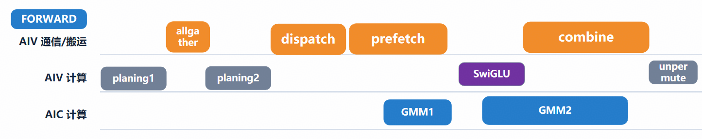

# 第七章｜MoonEP：负载均衡为什么值得焊进大算子

> **进阶篇 1/3** ｜ [返回目录](../README.md)

**一句话：负载不均时，最忙 rank 可能拖慢整层；MoonEP 用“热专家开分店（副本）”分担工作。把规划、权重预取和梯度归约结合进大算子的调度，可以减少其暴露开销，是否划算还要比较净收益。**

## 7.1 木桶效应

EP 把专家切到各卡后，最朴素的命运是：**router 说大家都要找专家 37，专家 37 所在的那张卡就成了急诊科**——别的卡算完只能等它。整层耗时 = 最忙 rank 的耗时，这就是木桶效应。传统解法是 capacity + drop（座位满了就扔 token，扔的是质量），或者在训练期加辅助损失逼 router 分流（那是路由算法层面的事，见 7.4 的谱系）。

MoonEP 的思路不同：**给热门专家开分店。** 每个 rank 除自己的 home 专家外，再接收若干**副本（replica）专家**的权重拷贝，按规划表把路由分配给 owner 或副本。被选中的逻辑专家不变，改变的是实际执行它的 rank；具体分配规则见下面的 B.0–B.3，并非简单选择“最近”的副本。

### 四个 token：给 e0 开一家分店

保持第二章的 token、专家归属和路由权重，只把专家选择改成下面这组偏斜输入。它是同一个小例子的另一种路由，用来观察负载变化：

| token | 专家选择（slot 0 / slot 1） | 权重（保持原值） |
|---|---|---|
| 0 | e0 / e1 | 0.75 / 0.25 |
| 1 | e0 / e2 | 0.60 / 0.40 |
| 2 | e0 / e1 | 0.50 / 0.50 |
| 3 | e0 / e3 | 0.20 / 0.80 |

e0 收到 4 行，e1 收到 2 行，e2、e3 各 1 行；按原归属，rank 0 算 6 行、rank 1 算 2 行。现在把 e0 的权重复制到 rank 1，让 token 2、3 的 e0 路由（route_id 4、6）去该副本执行，负载就变成 `[4,4]`。

注意：token 2 仍然选择 e0，权重仍是 0.50，结果仍按 route_id 4 返回；它没有被改派给另一个逻辑专家。训练时，rank 1 上这两行对 e0 权重的梯度，还要与 owner 上的另外两行相加。**副本分担执行，参数更新仍属于同一个逻辑专家。**

[CPU 小实验](../examples/README.md) 会核对副本分担前后的输出及梯度。这只是手工指定两条路由迁移的教学示例，不是 B.0–B.3 规划器的复刻。它也不代表两倍提速：实际还要付权重复制、规划、梯度归约的代价，小 GEMM 的效率也可能变化。

## 7.2 B.0–B.3：四步规划

副本怎么选、流量怎么分？MoonEP 在设备端跑一个四步规划（host 侧有一个纯 torch 参考实现，正好当教材）：

```python
# src/mega_moe/runtime/moonep_planning.py:238-249（摘）
def plan_moonep_b0_b3(tpe_all: torch.Tensor) -> MoonEPPlanningResult:
    """Build MoonEP B.0-B.3 tables for dropless Mega-MoE routing.

    Args:
        tpe_all: Contiguous CPU int32/int64 counts shaped ``[R, E]``. Every
            row must have the same sum, ``E`` must be divisible by ``R``...
    Returns:
        A result containing contiguous CPU int32 ``alloc_cumsum [E, R]`` and
        ``experts_to_copy [R, E/R]``.
    """
```

四步分别是：**B.0** 数清楚每个专家全网要接多少 token（得到各 home 组负载）；**B.1** 用"单源填充"求一张转移表 `transfers[R][R]`，让每个目的 rank 的总负载相等；**B.2** 按配额把每个 home 组的流量贪心切给各目的 rank（产出 `allocation`）；**B.3** 给每个目的 rank 挑出它实际需要的远程专家，填进**副本槽**——产出上面代码里的 `experts_to_copy [R, E/R]`（行话 ETC 表）。

副本槽预算在算子构造时就定死（注意 physical = 2 × home）：

```python
# src/mega_moe/ops/forward.py:126-133（摘）
if self.enable_moonep and self.world_size & (self.world_size - 1):
    raise ValueError(
        "MoonEP Triton planning requires a power-of-two EP world size")
self.replica_budget = self.experts_per_rank if self.enable_moonep else 0
self.physical_experts_per_rank = (
    self.experts_per_rank + self.replica_budget
)
```

规划完，路由把 token 映射到 `[home | replica]` 物理桶，之后前向照常跑——只是每个专家可能有多份权重拷贝在各 rank 上。

## 7.3 权重从哪来：owner-push 预取

副本要有权重才能算。规划一落地，**拥有该专家的 rank（owner）主动把权重 RMA 推进**所有需要它的目的 rank 的对称副本表——gate/up 按 16MB 块、down 按 4MB 块推，每块推完 `signal_op SET(届号)`。反向时倒过来：各副本上攒出的权重梯度，owner 把它们 pull 回来累加（owner-pull 归约）。

## 7.4 负载均衡方法谱系（横向视野）

把 MoonEP 放回谱系里看，负载均衡三代方法：

- **辅助损失（aux loss）**：训练时给 router 加一项"不均衡罚金"（Switch/DeepSeek 系），逼它雨露均沾——有效但和主损失打架，权重难调；
- **router z-loss**：罚 logits 的绝对值，稳定数值进而稳定路由（ST-MoE）；
- **免损失偏置（DeepSeek-V3 bias）**：给每个专家的得分加一个动态偏置，超载就调低——不用改损失函数，"排队叫号"式柔性引导；
- **expert choice**：反过来让专家挑 token，天生均衡但训练/推理语义有出入；
- **node-limited routing**：限制每个 token 只能路由到有限几个节点内的专家，砍跨机流量（通信维度的"均衡"）；
- **副本式（MoonEP）**：训练时不干预路由，系统侧用副本吸收不均——**前几类是"劝人少排队"，MoonEP 是"多开窗口"**。

## 7.5 实测效果：怎么量、量到了什么

负载均衡的收益怎么测？仓库里有一组刻意设计的**配对倾斜用例**（控制变量法）：

```python
# config/_shapes.py:239-256（摘）
# Matched unbalanced Kimi cases: only total expert count differs. Keep the
# old top-k=8 trimmed case above for existing performance regressions.
CaseGroup(
    prefix="performance-fwd-kimi-k3-trimmed-skewed", ...,
    topk=16, num_experts=32, ...,
    tags=frozenset({..., "moonep-skewed", "slow"}),
    capacity_factor=1.6875,
),
CaseGroup(
    prefix="performance-fwd-kimi-k3-skewed", ...,
    topk=16, num_experts=896, ...,
    tags=frozenset({..., "moonep-skewed", "slow"}),
    capacity_factor=1.6875,
),
```

设计意图写在注释第一行：在相同 hidden/ffn/topk、token 数和 owner 负载剖面下，比较 32 与 896 个专家（8 卡下每卡 4 个与 112 个 home 专家）。**两者的 rank 级倾斜比例相同**；专家总数变化还改变了每个专家的行数、GEMM 粒度、权重规模和元数据开销，因此两者 E2E 的差不能直接叫“倾斜税”。

要观察倾斜影响，应固定专家数和其他配置，比较均衡与偏斜路由；要观察 MoonEP 的净收益，应固定同一组路由、输入和权重，比较开/关 MoonEP 的完整耗时，包含规划、预取及训练所需的梯度归约。上面的四 token 例子也遵守这个区别：`[6,2]→[4,4]` 的副本对照用的是同一份偏斜路由。

那个 1.6875 不是拍的，是从路由剖面里算出来的。倾斜由 `KIMI_OWNER_COUNTS = (19, 27, 11, 11, 15, 15, 15, 15)` 写死（`benchmark/layer/_kimi_routes.py`）：每 128 份路由 8 个 owner 分，均值 16 份，最热的 owner 拿 27 份——**27/16 = 1.6875，正是最热 rank 的实际接收倍数**。cf 开到正好兜住它（T=2048 档对应 378 MiB 接收区），比满配保险 cf=8（1.75 GiB）便宜 4.7 倍，一行余量都不多留——4.6 节说的"知情下注"，这里就是下注的算法。顺带一个反直觉的事实：**开着 MoonEP 的那条臂其实只用到 cf=1.0**——B.1/B.2 会把每个目的 rank 精确压到共同容量 T·k（`routing.py` 里那句 "balance every destination to the common dropless source capacity"），这 0.6875 的余量全是给关掉 MoonEP 的对照臂准备的。

**所以从 capacity_factor 这个变量看，MoonEP 的价值不止于"每张卡算得更均衡"的性能账——它还能减少对称内存的分配。** 倾斜被抹平之后，接收区不再需要为最坏情况预留余量：cf 从 1.6875 压回 1.0，按 T=2048 档算就是每 rank 每层实例省下 154 MiB（378 → 224 MiB）的对称堆地产——别忘了这块地出自那个不走 caching allocator、建会话时一次性预留的固定 arena（4.6 节），省下来的是实打实的稀缺资源。

当然这笔省法不是白来的，得把账记全：MoonEP 在对称堆的另一侧开了副本权重表和 replica 就绪槽（7.3 的 owner-push 就推进那张表），**省的是接收区的"倾斜保险"，花的是副本权重的固定地盘**。但两者的性质不同：副本表按 replica_budget 定死，是看得见摸得着的静态成本；倾斜余量是为路由的不确定性买的保险。把一份不确定的保险兑换成一份确定的静态成本，正是系统工程里划算的那类兑换。

目前的实测现状（如实说）：

- Mega-MoE-TD 仓库 README 的主性能表（前向 1.17–1.30×、反向 1.19–1.56×）是**无 MoonEP** 的 home-EP 路径；MoonEP 专项的开关对照数字**待补**（跑 `moonep-skewed` 配对用例后填入，见本教程 README 待补清单）；
- 功能面：反向全路径已支持 MoonEP replica（`MOE_BWD_MEGA` 普通版与 recompute 版两条路径都打勾，见 Mega-MoE-TD 仓库 README 功能表）；
- 整网集成：[MindSpeed-MM_MoonEP](https://gitcode.com/jzhoujg/MindSpeed-MM_MoonEP.git)（`moonep` 分支）提供 kimi-k3 端到端训练入口。

## 7.6 为什么值得结合大算子的调度

如果把规划、权重推送、dispatch、计算和梯度归约逐个串行排在 host 上，规划与通信的暴露时间可能吃掉均衡收益。多 kernel 实现也可以用异步事件和分块调度重叠这些步骤；大算子的价值在于进一步减少 host 交接，并把权重与 token 的就绪管理放到更细的粒度。

本库把规划放到设备端（`_kernel_moonep_b0_b1`），在 dispatch/FC1 的调度中安排 down 权重预取，并利用反向的窗口安排副本梯度归约。这些设计使均衡开销有机会与计算重叠，但不保证全部被隐藏；是否划算取决于偏斜程度、复制量、链路和计算规模，应由完整路径的开关对照确认。



*三车道视角：planing1/planing2 排在计算道前部，dispatch 期间安排 prefetch（权重预取），SwiGLU 与 GMM2 错位执行。图表示可重叠的调度关系，不是“开销全部消失”的实测证明。*

## 7.7 开发者注记（验证入口）

（给第三类读者）

- 正确性：`tests/layer/test_moe_suite.py::test_single_kernel_moonep_autograd_w2`（MoonEP 前反向一体的单测门）；
- 性能：配对用例 case id `performance-fwd-kimi-k3-skewed` / `performance-fwd-kimi-k3-trimmed-skewed`（见 7.5，开关 MoonEP 对照）；
- 整网：[MindSpeed-MM_MoonEP](https://gitcode.com/jzhoujg/MindSpeed-MM_MoonEP.git) `moonep` 分支。

## 7.8 小结

木桶效应 → 副本式均衡（B.0–B.3 规划 + owner-push 预取 + owner-pull 归约）→ 结合设备调度。开关对照要固定路由，E32/E896 对照则用于观察专家规模的影响；接收区的倾斜余量可以减少，但要同时计入副本权重的内存成本。**下一章讲另一个可以结合大算子调度的设计：选择性重算。**

---

← [上一章](06-npu-vs-gpu.md) ｜ [返回目录](../README.md) ｜ [下一章：重算](08-recompute.md) →
