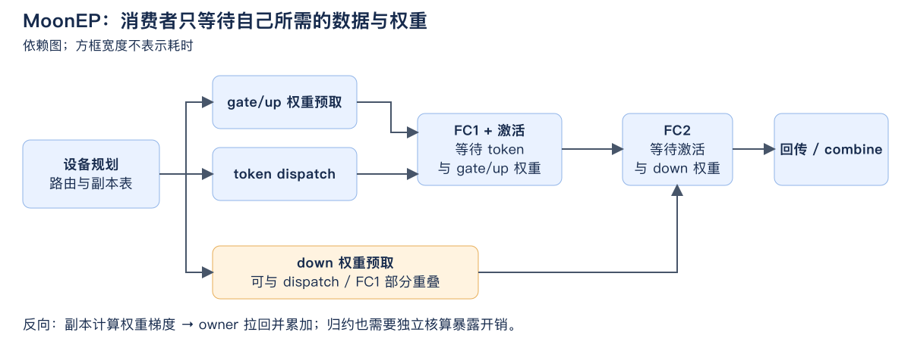

# 第七章｜MoonEP：负载均衡为什么值得焊进大算子

> **进阶篇 1/3** ｜ [返回目录](../README.md)

**一句话：负载不均时，最忙 rank 可能拖慢整层；MoonEP 用“热专家开分店（副本）”分担工作。把规划、权重预取和梯度归约结合进大算子的调度，可以减少其暴露开销，是否划算还要比较净收益。**

## 7.1 木桶效应

EP 把专家切到各卡后，如果 router 把大量 token 交给专家 37，它所在的 rank 就可能成为整层的瓶颈。其他 rank 提前算完，也要等它交付结果，这就是负载不均带来的木桶效应。常见应对方式包括限制专家容量、丢弃超额路由，或在训练期用辅助损失引导 router 分流；前者可能影响模型质量，后者改变了训练目标。相关方法放在 7.6 节比较。

MoonEP 的思路不同：**给热门专家开分店。** 每个 rank 除自己的 home 专家外，再接收若干**副本（replica）专家**的权重拷贝，按规划表把路由分配给 owner 或副本。被选中的逻辑专家不变，改变的是实际执行它的 rank；具体分配规则见下面的 B.0–B.3，并非简单选择“最近”的副本。

### 四个 token：给 e0 开一家分店

保持第二章的 token、专家归属和路由权重，只把专家选择改成下面这组偏斜输入。它是同一个小例子的另一种路由，用来观察负载变化：

| token | 专家选择（slot 0 / slot 1） | 权重（保持原值） |
|---|---|---|
| 0 | e0 / e1 | 0.75 / 0.25 |
| 1 | e0 / e2 | 0.60 / 0.40 |
| 2 | e0 / e1 | 0.50 / 0.50 |
| 3 | e0 / e3 | 0.20 / 0.80 |

e0 收到 4 行，e1 收到 2 行，e2、e3 各 1 行；按原归属，rank 0 算 6 行、rank 1 算 2 行。现在把 e0 的权重复制到 rank 1，让 token 2、3 的 e0 路由（route_id 4、6）去该副本执行，负载就变成 `[4,4]`。

注意：token 2 仍然选择 e0，权重仍是 0.50，结果仍按 route_id 4 返回；它没有被改派给另一个逻辑专家。训练时，rank 1 上这两行对 e0 权重的梯度，还要与 owner 上的另外两行相加。**副本分担执行，参数更新仍属于同一个逻辑专家。**

[CPU 小实验](../examples/README.md) 会核对副本分担前后的输出及梯度。这只是手工指定两条路由迁移的教学示例，不是 B.0–B.3 规划器的复刻。它也不代表两倍提速：实际还要付权重复制、规划、梯度归约的代价，小 GEMM 的效率也可能变化。

## 7.2 B.0–B.3：四步规划

副本怎么选、流量怎么分？先看本教程所依据的 `release_v4` 四步规划。设 EP 大小为 R、逻辑专家总数为 E，输入 `tpe_all[R,E]` 记录每个来源 rank 发给各专家的路由行数。各来源的总行数相同，才能使用下面的共同容量。

| 步骤 | 输入 | 产出与作用 |
|---|---|---|
| B.0：统计负载 | 各来源的专家计数 | 汇总每个专家的行数，再按 home 归属得到各 rank 负载 |
| B.1：决定转移量 | home 负载、共同容量 | 用“单源填充”求 `transfers[R,R]`，决定各 home 组向各目的 rank 转移多少行 |
| B.2：分配专家流量 | 转移配额、专家行数 | 把各 home 组的流量贪心分配到目的 rank，生成 `allocation` |
| B.3：安排副本槽 | 各目的 rank 实际分到的专家 | 为远程专家分配槽位，生成 `experts_to_copy[R,E/R]`，未使用的槽记为 -1 |

最终还会把 allocation 转成 `alloc_cumsum[E,R]`：沿目的 rank 累加每个专家的行数，供路由确定每段流量的去向。host 参考入口是 `runtime/moonep_planning.py::plan_moonep_b0_b3`；设备端实现位于 `kernels/moonep_planning.py`。

副本槽预算在算子构造时确定：每 rank 有 E/R 个 home 槽，再预留 E/R 个 replica 槽。因此 **physical 槽数 = 2 × home 槽数**，不表示每个专家每次都会复制。

```python
# src/mega_moe/ops/forward.py（摘，省略其他构造检查）
self.replica_budget = self.experts_per_rank if self.enable_moonep else 0
self.physical_experts_per_rank = (
    self.experts_per_rank + self.replica_budget
)
```

规划完，路由把 token 映射到 `[home | replica]` 物理桶，后续计算按桶消费。四 token 例子中的 e0 仍是同一个逻辑专家，只是部分行进入了 rank 1 的副本桶。

> **版本边界**：以上讲的是 `release_v4` 的精确均衡方案。本地可见的 `origin/main`（`554db9a`，2026-10-19）已合入 improved-v2 规划，允许保留受限的额外接收行数。因此“每个 rank 恰好接收 T·k 行”不能直接套到新分支；容量差异见 7.5。第八章还会讨论该分支新增的 FC1 重算。

## 7.3 权重从哪来，梯度往哪去

副本要先拿到权重才能算。拥有该专家的 rank 称为 **owner**：规划完成后，它通过 RMA 把权重推送到需要副本的 rank，这就是 owner-push。当前分块配置中，gate/up 默认按 16 MiB、down 按 4 MiB 搬运；消费者依据就绪信号确认所需权重已经可读。信号中的轮次标识（epoch）用于区分不同次执行，原理见第四章。

训练时还有反方向的工作：副本处理的 token 也会贡献权重梯度，owner 需要把这些贡献拉回并相加，即 owner-pull 归约。拿四 token 例子来说，e0 的完整梯度必须包含两张卡各自处理的两行。

所以“开分店”至少多了三项成本：**规划执行位置、复制专家权重、合并副本梯度**。接下来要解决的，就是让这些工作尽量不延长整层的关键路径。

## 7.4 为什么值得结合大算子的调度

如果把规划、权重推送、dispatch、计算和梯度归约依次串行执行，新增开销可能吃掉均衡收益。多 kernel 实现可以用异步事件和分块调度重叠这些步骤；大算子则进一步减少 host 交接，并在设备端细化权重与 token 的就绪管理。

这不是“等所有副本权重搬完，再统一开始计算”。FC1 需要 gate/up 权重，FC2 才需要 down 权重：只要相应数据和权重已就绪，消费者就可以推进，较晚使用的权重还有预取窗口。反向同样可以利用计算窗口安排副本梯度归约。



*箭头表示依赖。down 权重预取可与 dispatch/FC1 的部分工作重叠，实际重叠量取决于调度和资源竞争；图中方框宽度不代表时间。*

本库把规划放到设备端（如 `_kernel_moonep_b0_b1`），再把预取、计算和归约接入调度。这样做为隐藏开销创造了条件，是否划算仍要用完整路径的开关对照确认。

## 7.5 收益如何验证：时间与内存分开记账

负载均衡的收益怎么测？仓库里有一组刻意设计的**配对倾斜用例**（控制变量法）：

```python
# config/_shapes.py:239-256（摘）
# Matched unbalanced Kimi cases: only total expert count differs. Keep the
# old top-k=8 trimmed case above for existing performance regressions.
CaseGroup(
    prefix="performance-fwd-kimi-k3-trimmed-skewed", ...,
    topk=16, num_experts=32, ...,
    tags=frozenset({..., "moonep-skewed", "slow"}),
    capacity_factor=1.6875,
),
CaseGroup(
    prefix="performance-fwd-kimi-k3-skewed", ...,
    topk=16, num_experts=896, ...,
    tags=frozenset({..., "moonep-skewed", "slow"}),
    capacity_factor=1.6875,
),
```

设计意图写在注释第一行：在相同 hidden/ffn/topk、token 数和 owner 负载剖面下，比较 32 与 896 个专家（8 卡下每卡 4 个与 112 个 home 专家）。**两者的 rank 级倾斜比例相同**；专家总数变化还改变了每个专家的行数、GEMM 粒度、权重规模和元数据开销，因此两者 E2E 的差不能直接叫“倾斜税”。

要观察倾斜影响，应固定专家数和其他配置，比较均衡与偏斜路由；要观察 MoonEP 的净收益，应固定同一组路由、输入和权重，比较开/关 MoonEP 的完整耗时，包含规划、预取及训练所需的梯度归约。上面的四 token 例子也遵守这个区别：`[6,2]→[4,4]` 的副本对照用的是同一份偏斜路由。

### 接收区能缩小多少，不等于总显存能省多少

`capacity_factor=1.6875` 来自固定路由剖面 `KIMI_OWNER_COUNTS = (19,27,11,11,15,15,15,15)`：128 份路由由 8 个 owner 分担，均值 16，最热 owner 收到 27，故接收量为均值的 27/16 倍。

以 T=2048、k=16、H=3584、BF16 为例，只按**前向有效 token 接收量**计算：

| 路由状态 | 每 rank 所需最大接收行数 | token 数据量 |
|---|---:|---:|
| 上述固定偏斜，未均衡 | T·k·1.6875 | 378 MiB |
| 旧版规划精确均衡后 | T·k | 224 MiB |
| 两者差额 | T·k·0.6875 | 154 MiB |

这 154 MiB 是接收数据量的理论差额，**不能直接当作训练峰值显存的净节省，也不能据此把训练 cf 设为 1**。第四章讨论的 `release_v4` 默认 cf=2.0，还为反向 wgrad padding 留空间；`origin/main@554db9a` 的 improved-v2 允许至多 `floor(T·k·125/2048)` 额外接收行，默认 cf 相应变为 2.125，覆盖扩大的接收量与 padding。运行哪一版，就应检查那一版的 `config.py::resolved_receive_capacity_factor` 和容量校验。

此外，副本权重表、就绪槽和梯度工作区都占空间。副本权重的预算随专家数和 H、F 增长，可能大于省下的接收区。**时间收益与显存收益要分别测量**：既记录开关 MoonEP 的完整前反向耗时，也记录对称堆、普通设备分配及整网峰值，不能只比较一个缓冲区。

目前的实测现状（如实说）：

- Mega-MoE-TD 仓库 README 的主性能表（前向 1.17–1.30×、反向 1.19–1.56×）是**无 MoonEP** 的 home-EP 路径；MoonEP 专项的开关对照数字**待补**（跑 `moonep-skewed` 配对用例后填入，见本教程 README 待补清单）；
- 功能面：反向全路径已支持 MoonEP replica（`MOE_BWD_MEGA` 普通版与 recompute 版两条路径都打勾，见 Mega-MoE-TD 仓库 README 功能表）；
- 整网集成：[MindSpeed-MM_MoonEP](https://gitcode.com/jzhoujg/MindSpeed-MM_MoonEP.git)（`moonep` 分支）提供 kimi-k3 端到端训练入口。

## 7.6 扩展阅读：几类相关方法

这些方法作用于不同环节，可以组合使用，不必把它们排成一条替代关系：

| 作用位置 | 代表方法 | 改变什么 |
|---|---|---|
| 路由选择 | 辅助均衡损失 | 在训练目标中加入均衡约束，需要权衡主任务与均衡项 |
| 路由选择 | DeepSeek-V3 动态偏置 | 根据负载调整用于专家选择的偏置；选择偏置与最终路由权重的计算要区分 |
| 路由选择 | Expert Choice | 由专家选择 token，在给定专家容量下控制负载；每个 token 获得的专家数可能不同 |
| 通信范围 | Node-limited routing | 限制一个 token 涉及的节点数，降低跨节点通信范围，并不直接保证各 rank 等负载 |
| 执行位置 | MoonEP 副本分担 | 保留已选中的逻辑专家，把部分计算交给副本执行 |

另一个常见术语是 **router z-loss**（ST-MoE）：它惩罚路由 logits 的 log-sum-exp 的平方，主要用于数值稳定，不能与直接约束负载的辅助损失混为一谈。

## 7.7 开发者注记（验证入口）

（给第三类读者）

- 正确性：`tests/layer/test_moe_suite.py::test_single_kernel_moonep_autograd_w2`（MoonEP 前反向一体的单测门）；
- 性能：配对用例 case id `performance-fwd-kimi-k3-skewed` / `performance-fwd-kimi-k3-trimmed-skewed`（见 7.5，开关 MoonEP 对照）；
- 整网：[MindSpeed-MM_MoonEP](https://gitcode.com/jzhoujg/MindSpeed-MM_MoonEP.git) `moonep` 分支。

## 7.8 小结

木桶效应 → 副本式均衡（B.0–B.3 规划 + owner-push 预取 + owner-pull 归约）→ 结合设备调度。开关对照要固定路由，E32/E896 对照则用于观察专家规模的影响；接收区的倾斜余量可以减少，但要同时计入副本权重的内存成本。**下一章讲另一个可以结合大算子调度的设计：选择性重算。**

---

← [上一章](06-npu-vs-gpu.md) ｜ [返回目录](../README.md) ｜ [下一章：重算](08-recompute.md) →
