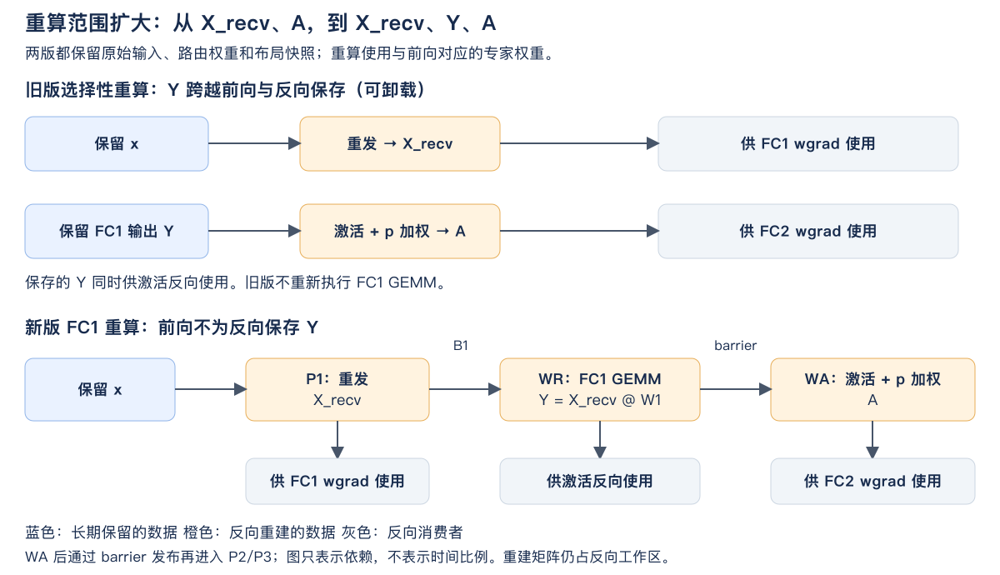

# 第八章｜省显存的艺术：从选择性重算到 FC1 重算

> **进阶篇 2/3** ｜ [返回目录](../README.md)

**一句话：反向需要前向的数据，但不一定要让这些数据一直留在显存里。旧方案保留或卸载 FC1 输出，重建接收 token 和加权激活；新方案进一步在反向重算 FC1，用额外 GEMM 换掉激活保存与主机往返。**

## 8.1 先看要保存什么

第二章说过，反向需要 dispatch 后的 token、FC1 输出、加权激活和路由元数据。大矩阵如果从前向一直保存到反向，多层叠加后就可能成为显存瓶颈。Activation checkpointing（激活检查点）的基本思路是只保存部分数据，其余在反向需要时重建；具体到 MoE，既可能重新计算，也可能重新通信。

本章先用基础实现解释选择性重算，再看后续方案为什么把 FC1 也纳入重算。以下新方案对应 2026-10-19 的实现状态：FC1 重算已于 10 月 17 日成为支持路径下的默认行为。

### 四个 token：哪些数据跨越前向与反向？

沿用[第二章的小例子](02-dispatch-to-combine.md)：全网 4 个 token 展开为 8 条路由，H=F=2。下表列的是全网逻辑形状，各 rank 只持有自己需要的部分。

| 数据 | 形状 / 内容 | 旧版选择性重算 | 新版增加 FC1 重算后 |
|---|---|---|---|
| 原始输入 x | `[4,2]` | 保留 | 保留 |
| 专家选择、路由权重 p | 各 `[4,2]` | 保留相关输入 / 快照 | 保留相关输入 / 快照 |
| 排列与接收布局 | order=`[0,4,2,6,1,3,5,7]` 等 | 保留；MoonEP 还需副本映射 | 保留相同映射 |
| 接收 token X_recv | `[8,2]` | 反向重新 dispatch | 反向重新 dispatch |
| FC1 输出 Y | `[8,4]` | 保存，可压缩或卸载 | 反向重新执行 FC1 GEMM |
| 加权激活 A | `[8,2]` | 从保存的 Y 和 p 重建 | 从重算的 Y 和 p 重建 |

以 e2 的两行为例，重新发送 token 0、1 可以恢复 X_recv。旧方案直接读取保存的 Y，再算 `silu(gate) * up * [0.25,0.40]` 得到 A；新方案先计算 `Y = X_recv @ W1`，再恢复 A。这里的 W1 是 gate/up 拼接后的专家权重，计算时必须使用与该次前向对应的参数。

[CPU 小实验](../examples/README.md) 验证的是旧版选择性重算：重建 X_recv 和 A，不重跑 FC1。它用于核对数据关系，不模拟新分支的设备调度，也不测通信或显存收益。

## 8.2 旧方案为什么保留 FC1？

在输入、参数、路由与激活配置一致的前提下，这三项都可以重建。但它们的代价不同：

| 重建对象 | 需要做的工作 | 主要消耗 |
|---|---|---|
| X_recv | 按原映射再次分发 x | 通信带宽、搬运和就绪同步 |
| Y | 执行 FC1 的 gate/up GEMM | cube 算力、权重与输入访存 |
| A | 对 Y 做激活、逐元素乘法及路由加权 | vector 算力与访存 |

旧方案先选择重建 X_recv 和 A，因此**不增加 FC1 GEMM**。它还有一个调度上的好处：Y 已经存在，A 可以在反向 P1 的 vector 窗口重建；X_recv 主要供后续 FC1 wgrad 使用，可以更晚重发，放在 B2→B3 的窗口里，与 FC1 dgrad 的 cube 计算重叠。

这解释了旧方案为什么先保留 Y，但不能据此断言保存永远更便宜。Y 的长期占用依然存在；把它卸载到主机，又会引入设备到主机（D2H）和主机到设备（H2D）的往返。新方案正是重新比较了这两笔成本。

## 8.3 为什么从 FC1 offload 转向全部重算？

### 卸载降低了常驻占用，却保留了搬运成本

FC1 offload 的路径是：前向保存 Y → 搬到 pinned 主机内存 → 反向前搬回设备。除了传输字节数，还要安排拷贝 stream、事件等待、pinned buffer 的复用与释放。异步发起拷贝，也不保证它能在消费者需要数据之前完成。

这条路径曾做过几轮优化：只搬有效行、把 H2D 提前到 attention backward 窗口，以及用设备进度信号让 D2H 尽早开始。其中 2026-10-17 的一项分块 D2H 探针发现，发布点已接近最后一波 FC1，剩余 combine/output 尾部不足以覆盖拷贝：该用例的 D2H 滞后只从 1.929 降到 1.892 ms，约改善 1.9%。这是 Kimi-K3 E32-K8、w4、S=1024、30 次前向循环的局部结果，不能当作整网收益。

这也说明，瓶颈可能是**可用的重叠窗口太短**。如果继续优化拷贝仍有明显暴露时间，就值得尝试不保存这份数据，反向直接算出来。

### 新方案怎样接进反向？

新版在同一次融合反向 launch 内重建 Y。与旧方案相比，它不仅多了一次 GEMM，还调整了依赖顺序：

1. **P1 窗口提前重发 x。** 先发出输出梯度，解锁 FC2 dgrad 的计算，再由 vector 子核重发原始输入；B1 发布重发结果。
2. **B1 后增加 WR 计算窗口。** cube 用 X_recv 和对应的 home/replica gate/up 权重重算 Y，完成后通过 barrier 发布。
3. **增加 WA 激活窗口。** vector 从新的 Y 重建 A，再通过 barrier 发布，之后 P2/P3 等梯度计算继续。



*蓝色表示跨越前向与反向保留的数据，橙色表示反向重建。图展示数据依赖，不表示耗时比例；Y 供激活反向使用，A 供 FC2 wgrad 使用，X_recv 供 FC1 wgrad 使用。*

新增的 FC1 GEMM 与 FC2 dgrad 共用 cube，WR/WA 也引入了发布屏障，因此不能把重算说成“全部藏进空闲窗口”。新方案节省的是 Y 的长期保存、保存写出及主机往返，代价是反向计算、同步和临时工作区。

这里的“全部重算”指 **X_recv、Y、A 这三项主要展开激活都在反向重建**。原始输入、路由权重、排列及副本映射仍需保留；不重新执行 router 的专家选择，也不重跑 FC2 前向。这与框架把整个 MoE 层重新前向一次的 checkpoint 是不同的实现，不能直接互换。

### 同组实测支持了什么取舍？

2026-10-17 的实践记录包含一组 DeepSeekV4 demo 整网对照：8×950DT、10 steps。对应 demo 为 4 层、64 专家、top-k=8、H=4096、F=2048、seq=1024、micro-batch=4；下表沿用该次测试报告的稳态时间与峰值显存口径。

| FC1 获取方式 | 稳态时间（s/step） | 比常驻保存多耗时 | 峰值显存 |
|---|---:|---:|---|
| 常驻设备保存 | 0.4659 | — | 基线 |
| 主机 offload | 0.5305 | 64.6 ms | 24.43 GB，较基线约少 2.0 GB |
| offload + G3 v1 分块 D2H | 0.5243 | 58.4 ms | 该次记录未单列 |
| 反向重算 FC1 | 0.4855 | 19.6 ms | 24.43 GB，与 offload 相同 |

在这组配置下，**重算保留了 offload 的显存收益，同时每步少用约 45 ms（约 8.5%）**；相对常驻保存的增量时间约为 offload 的三成。但常驻保存仍然更快，所以取舍是用约 20 ms/step 换约 2 GB 峰值空间，而不是重算无条件提速。

这些数值来自历史测试记录，本教程未重新跑真机；该记录没有附出完整原始样本和误差范围。记录还报告了 w2/w4/w8 功能验证通过，以及该整网测试的 grad norm 与基线逐步逐位一致；这不能代替其他形状、保存精度和工具链上的正确性与性能验证。

因此，后续实现将 FC1 重算设为支持路径的默认，并保留 offload 与常驻保存供对照。切换默认依据的是这组空间与时间的实测权衡：当主机链路和可用重叠窗口受限时，在设备上重建 Y 更划算；若计算资源或通信条件不同，结论仍需重测。

## 8.4 内存账：少保存，不等于反向不再占空间

设每个 rank 有 T 个原始 token，实际接收 M 条路由，H 为 hidden size、F 为 FFN 中间维。只计 BF16 数据主体，不计 padding、额外副本、元数据和 allocator 开销：

| 数据 | 形状 | 字节数 | T=2048、M=T·16、H=3584、F=3072 |
|---|---|---:|---:|
| 原始输入 x | `[T,H]` | 2TH | 14 MiB |
| 接收 token X_recv | `[M,H]` | 2MH | 224 MiB |
| FC1 输出 Y | `[M,2F]` | 4MF | 384 MiB |
| 加权激活 A | `[M,F]` | 2MF | 192 MiB |

旧方案避免长期保存 X_recv 和 A 的逻辑数据量是 416 MiB；新版进一步避免长期保存 Y 的 384 MiB。这里按每 rank、单层、指定 M 计算，实际偏斜或 padding 会改变 M 和分配大小。

反向仍然需要这些数据。新版会为重算 Y 分配 `[M,2F]` 的 BF16 工作区；X_recv 和 A 也有重建落点。因此应沿时间轴统计哪些张量同时存活，才能得到整网峰值。上面的逻辑数据量不能直接相加成峰值节省，也不能替代 8.3 的实测。

保存模式下，还可以用 `save_fc1_dtype` 选择 bf16、fp16 或 fp8。FP8 E4M3 的 Y 数据主体约减半，另需逐行、逐组 scale，并应评估梯度误差；fp16 和 bf16 都是两字节，互换不减少字节数。**新版 FC1 重算输出为 BF16，不经过 FC1 的 FP8 保存格式**，不要把“FP8 保存再减半”重复计入重算模式的收益。

## 8.5 为什么路由快照仍要留，什么时候捕获？

重算必须恢复同一条路由的行身份。固定输入和排序规则的稳定排序可以重现；若选择、同分处理和物理分配规则全部确定，元数据原则上也能重建。但重新规划若改变行顺序，就必须同步重排所有关联数据，否则激活或梯度会配错 token。

当前两种方案都保留计数、偏移、排列及副本映射，省去再次规划与验证的复杂度。MoonEP 下尤其要知道某条路由当时交给了哪个物理专家槽。元数据通常小于大激活，但仍须计入内存预算。

还有一个生命周期问题：**保存的是独立快照，还是会被后续步骤覆写的工作区视图？** 以多 kernel 的 native-saved 路径为例，规划工作区可能被下一次调用复用，接收区又会被 FC2 回传覆写，所以顺序应当是：

```text
规划完成 → 立即捕获布局快照
         → dispatch / FC1
         → 捕获需要保存的接收激活
         → FC2 回传复用接收区
```

选择重算后可以省去相应激活的保存，但输入和路由快照仍需存活到反向消费完毕。主机卸载还必须保证 D2H 完成前源数据有效、H2D 完成后消费者才能读；这也是 offload 除带宽之外的工程成本。

## 8.6 开发者注记：版本、开关与验证入口

新版统一通过 `runtime/fc1_mode.py::fc1_recompute_default()` 决定 FC1 的获取方式。以下对照针对**单 kernel 前向 + 融合反向**，且已开启 `MOE_BWD_MEGA=1`、`MOE_SAVED_RECOMPUTE=1`：

| `MEGAMOE_BWD_FC1_RECOMPUTE` | `MEGAMOE_FC1_OFFLOAD` | FC1 获取方式 |
|---|---|---|
| 未设置 | 未设置或 0 | 默认重算 |
| 未设置 | 1 | 保存并卸载到主机 |
| 1 | 任意 | 显式重算优先，无 FC1 保存数据可卸载 |
| 0 | 未设置或 0 | 常驻设备保存 |
| 0 | 1 | 保存并卸载到主机 |

因此，要回退到常驻保存，既要关闭 FC1 重算，也要关闭 offload。支持条件以调用路径与该函数为准，不能只向任意算子设置一个环境变量。

阅读源码时可沿下面几个入口核对：

- `ops/forward.py`：`save_fc1_for_bwd = return_saved and not _fc1_recompute` 控制是否为反向保存 FC1。
- `ops/_single_saved_adapter.py` 与 `ops/backward.py`：重算模式允许 saved 中没有 `fc1_output`，仍检查必要的路由数据。
- `kernels/mega_bwd.py`：`FC1_RECOMPUTE` 分支安排提前 re-dispatch、WR GEMM 和 WA 激活重建。
- `ops/_native_saved.py`：多 kernel 路径的 `snapshot_plan_metadata`、`capture_activations`、`assemble_native_saved` 对应布局快照、激活捕获和契约组装。文件中“39 键”描述的是早期参考契约，不是所有路径必须保存的固定数量。

评估时同时记录正确性、峰值显存、单步耗时和整网吞吐。释放空间可能允许更大 batch 或更长序列，这时需要在目标工作负载上重新比较，不能仅凭单层重算耗时判断最终收益。

## 8.7 小结

重算设计要同时回答三件事：哪些数据可以恢复、恢复成本落在哪些资源上、哪些数据仍要跨阶段保存。旧方案用 re-dispatch 和激活重建降低保存量；新版再用一次 FC1 GEMM 替代 Y 的长期保存与主机往返。路由身份和生命周期始终是正确性的前提。**最后一章把这些依赖放回全局调度，解释前向波流水与反向相位制的选择。**

---

← [上一章](07-moonep.md) ｜ [返回目录](../README.md) ｜ [下一章：全局流水](09-global-pipeline.md) →
