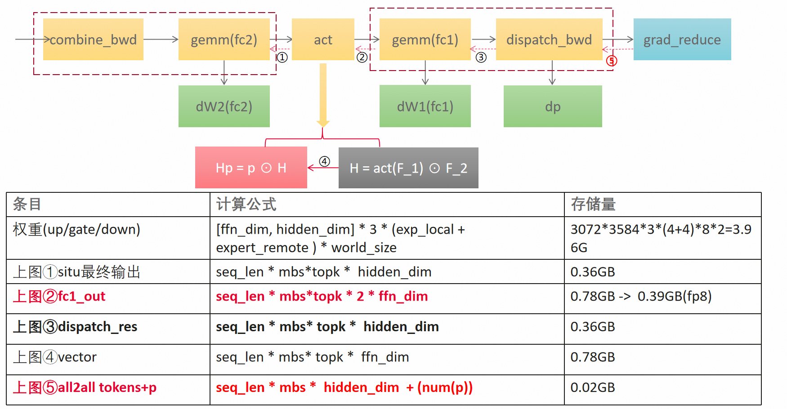

# 第八章｜省显存的艺术：重算怎么设计

> **进阶篇 2/3** ｜ [返回目录](../README.md)

**一句话：反向需要前向的“小票”，重算是在决定哪些可以重新补打。本库保留路由快照与 FC1 输出，在反向中重建接收 token 和加权激活，用额外通信及逐元素计算换取保存空间。**

## 8.1 矛盾

第二章说过，反向要吃前向的一堆中间量：dispatch 后的 token、FC1 输出、路由元数据……`_native_saved.py` 里的完整契约有 39 个键。Kimi-K3 规模下，光 fc1_output 一项就是几百 MB 每层——几十层 MoE 堆起来，显存直接判死刑。

经典的解法叫 activation checkpointing（梯度检查点）：前向只存关键帧，反向要用时重算。MoE 的重算有自己的特殊性，设计成三问。

## 8.2 第一问：什么能重算？

**激活在数学上可以重算。** 输入、权重和路由一致时，FC1 输出可以重新执行 GEMM 得到，加权 SwiGLU 可以由 FC1 输出和路由权重得到。接收 token 也能重建：拿着原始 `hidden_states` 和保存的排列表，再 dispatch 一遍。当前 `MOE_SAVED_RECOMPUTE=1` 选择后两项，仍然保存 FC1 输出，并没有重跑 FC1 GEMM（8.5 展开）。

## 8.3 第二问：为什么保留排列元数据？

**本实现选择保存排列元数据，避免重复规划并保证行身份一致。** 固定输入和排序规则的稳定排序可以重现，并非天然随机；如果路由选择、同分处理、物理分配规则都确定，元数据在原理上也可以重建。但若重新规划改变了行顺序，却仍使用旧顺序保存的 FC1 输出或权重，梯度就会配错 token。要重建，就必须恢复相同映射，或一致地重排所有关联数据。

当前方案保留计数、偏移、排列及副本映射的快照，收益是省去再次规划与验证的复杂度。这些表通常比大激活小，但它们同样占用内存，规模大时也应计入预算：

```python
# src/mega_moe/ops/_native_saved.py:312-319（摘）
def snapshot_plan_metadata(op, plan: MoERoutingPlan) -> dict:
    """T1 — snapshot one routing plan for the native ``saved`` dict.

    Must run immediately after ``build_routing_plan`` returned ...
    Every returned tensor is a clone or a freshly computed value, so the
    single-in-flight planning workspace may be reused afterwards.
    """
```

## 8.4 第三问：什么时候存、存多久？

存激活有个**时间窗**问题。以多 kernel 的 native-saved 路径为例，dispatch 接收区会被后续阶段复用，必须在 FC2 回传覆写之前捕获反向所需的激活：

```python
# src/mega_moe/ops/_native_saved.py:336-345（摘）
def capture_activations(op, dispatch_result, workspace=None):
    """T2 — snapshot the forward activations the backward needs.

    Call site: inside ``FusedMoEForward.forward`` between the ``dispatch_fc1``
    result and the ``_fc2_combine_shadow_activation`` launch. ... this window
    is mandatory because FC2's device-put workers and backward step 1 both
    overwrite the peer-memory receive view.
    """
```

T1（规划快照）→ T2（激活捕获，必须在 FC2 覆写之前）→ T3（组装 39 键 saved）——三段式，一步都不能错位。

## 8.5 重算路径：最小 saved 契约

单 kernel 前向 + 融合反向的选择性重算组合下，保存 FC1 输出、路由权重与布局快照，并保留原始 `hidden_states`；扩展后的接收 token 矩阵和加权激活在反向 kernel 内重建。下面只是允许省略部分激活的准入判断，不是完整 saved 字段清单：

```python
# src/mega_moe/ops/backward.py:123-143（摘）
# Single-kernel-forward minimal contract: the big activations are
# NOT saved — the fused mega backward re-derives them in-launch
# (recv_hidden via re-dispatch, act rows from fc1_output).  Only
# that one combination may run without recv_hidden_sorted ...
_single_kernel_recompute = (
    "recv_counts_by_source_expert" in saved
    and "fc1_output" in saved
    and "recv_weights_sorted" in saved
    and os.environ.get("MOE_BWD_MEGA") == "1"
    and os.environ.get("MOE_SAVED_RECOMPUTE", "0") == "1"
)
```

`mega_bwd.py` 的重算说明明确写着 **“fc1_output is NOT recomputed”**。`recv_hidden_sorted` 用 re-dispatch 补回，`swiglu_out_weighted` 从保存的 FC1 输出重新做 SwiGLU 与逐行加权。增量工作是一遍 token 分发，以及逐元素激活、乘法和相应访存；不额外执行 FC1 GEMM。反向原本需要的四个梯度 GEMM 仍正常执行。

### 四个 token：究竟留下哪些“小票”？

沿用 [第二章的小例子](02-dispatch-to-combine.md)：全网 4 个 token 展开成 8 条路由，H=F=2。下面按全网逻辑形状列账，各 rank 只持有自己需要的部分：

| 数据 | 形状 / 内容 | 当前选择性重算的做法 |
|---|---|---|
| 原始输入 x | `[4,2]` | 保留，各来源 rank 保存自己的两行 |
| 专家选择、路由权重 | 各 `[4,2]` | 保留路由相关输入 / 快照 |
| 排列和接收布局 | order=`[0,4,2,6,1,3,5,7]` 等 | 保留；有副本时还需物理映射 |
| FC1 输出 Y | `[8,4]` | 保存，可按配置压缩或卸载 |
| 接收 token X_recv | `[8,2]` | 反向按原映射重新分发 x |
| 加权激活 A | `[8,2]` | 从保存的 Y 和对应权重逐行重建 |

例如 e2 的接收行仍须对应 token 0、1；从原始输入重发这两行，就恢复了它的 X_recv。用已经保存的两行 Y 做 `silu(gate) * up * [0.25,0.40]`，就恢复了 A。**这里没有再算 `X_recv @ W1`。** [CPU 小实验](../examples/README.md) 会逐项核对重建值；它模拟数据关系，不测真实通信或设备显存。

省下的是前向到反向之间持续保存这些展开激活的成本，不是让反向完全不需要它们。还要计入重建工作区、原始输入和存活重叠，才能得到整网峰值显存的净变化。



*图中反向主线照常执行，接收 token 和加权激活从保存的数据补回。右侧是特定形状下的示意账，不能直接套用到四 token 例子或其他模型；FC1 输出、输入 token、路由元数据应分别计量，FP8 保存还需计入 scale。*

## 8.6 三种省显存手段

压缩、卸载和选择性重算作用于不同数据，可以按支持条件组合；它们的实际代价没有固定的高低顺序：

1. **选择保存精度**：`save_fc1_dtype` 支持 bf16、fp16 和 fp8。FP8 使用 E4M3 + 逐行/逐组 scale，相比 16 位保存，数据主体约省一半；fp16 和 bf16 都是两字节，彼此切换并不减半内存。压缩还需评估梯度误差；
2. **搬主机**：`MEGAMOE_FC1_OFFLOAD=1` 把 fc1_output 挪到 pinned 主机内存，反向入口再搬回来——把仓库从显存这块黄金地段搬去郊区（代码思想见第五章 5.5）；
3. **选择性重算**：`MOE_SAVED_RECOMPUTE=1`，重建接收 token 和加权激活，保留 FC1 输出，如上。

**为什么说重算本质是 trade-off？** re-dispatch 消耗通信带宽，激活重建消耗 vector 算力和访存；若这些工作能落进现有 GEMM 的空闲窗口，增量墙钟可能小于它们独立运行的时间。释放的保存空间又可能允许更大的 batch 或更长序列。所以应一起测峰值显存、单步耗时和整网吞吐，再决定怎么兑换，不能仅凭“显存够不够”判断是否值得。

## 8.7 开发者注记（开关速查）

（给第三类读者）

- `MEGAMOE_FC1_OFFLOAD=1`：fc1_output 搬主机（pinned 池 + 旁路 stream）；
- `MOE_SAVED_RECOMPUTE=1`：上述选择性重算，必须与 `MOE_BWD_MEGA=1` **同开**，并满足 saved 契约；
- `save_fc1_dtype`：通过 `MoEForwardConfig(save_fc1_dtype=...)` 传入，选择 `bf16` / `fp16` / `fp8` 保存。

## 8.8 小结

当前方案保留 FC1 输出和路由快照，重建接收 token 与加权激活；保存时要赶在接收区被复用之前。元数据能否重建取决于映射的可重现性，当前实现选择存下来。保存精度、主机卸载和选择性重算共同提供空间与时间的取舍。**最后一章，讲前向的全局流水与反向的相位制选择。**

---

← [上一章](07-moonep.md) ｜ [返回目录](../README.md) ｜ [下一章：全局流水](09-global-pipeline.md) →
