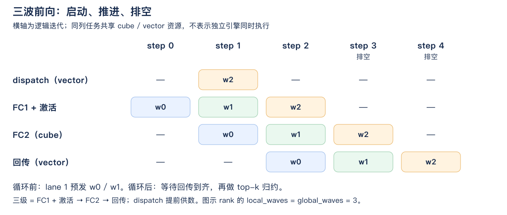

# 第九章｜前向的全局流水，以及反向的相位制选择

> **进阶篇 3/3 · 压轴** ｜ [返回目录](../README.md)

**一句话：前向的线性数据流便于按波推进；反向同样可以流水化，但多分支依赖、权重梯度累计、缓冲生命周期和工具链约束增加了成本，所以当前实现以相位制 + 段内并行为骨架。**

## 9.1 全局流水长什么样

第三章讲“哪些工作可以重叠”，第六章讲“由哪些执行资源承担”，这一章关注调度顺序：数据分批后，怎样启动、推进并排空整条流水。

`enable_single_kernel_forward=True` 时，整个前向在一次 all-core launch 中完成。路由元数据准备好后，`_run_dynamic_wave_pipeline` 按波（wave）推进：先把各专家的接收行切成 M 方向的块，再按 `WAVE_WINDOWS` 个块组成一波。一波可能跨越专家边界，一个专家也可能分到多波。

这里的**三级**指 FC1+激活、FC2、结果回传；dispatch 提前供应输入，最后的 top-k 归约在回传到齐后执行。全局循环取各 rank 波数的最大值，本地计算则按自己的波数判断是否有工作。循环骨架如下：

```python
# src/mega_moe/kernels/fused_forward.py::_run_dynamic_wave_pipeline（节选）
global_waves = 0
for rank in range(WORLD_SIZE):            # 波数 = 全网最忙 rank 的波数
    blocks = tl.load(wave_expert_offsets_ptr + ...)
    global_waves = tl.maximum(global_waves, tl.cdiv(blocks, WAVE_WINDOWS))
...
# Empty receive ranks still dispatch every global wave. Keeping dispatch
# ahead of all return waits prevents a cross-rank dependency cycle.
for step in range(global_waves + 2):
    with al.scope(core_mode='vector', disable_auto_sync=True):
        if (sub_vec_id() == 1) & (step > 0) & (step + 1 < global_waves):
            _dispatch_dynamic_wave(pid, step + 1, ...)   # 发下一波
```

### 三波走完：启动、推进与排空

假设全局最多有三波 w0、w1、w2，下图展示一个本地也有三波的 rank。循环前，vector lane 1 先发 w0/w1；step 1 再发 w2。



*横轴是循环迭代，不是等长的时间片；同一列表示该次迭代安排的任务，不保证同时执行。不同颜色标出同一波从 FC1 到回传的推进。*

在 step 2，w2 做 FC1，w1 做 FC2，w0 回传；此时三个阶段都有工作。随后不再引入新波，step 3 完成 w2 的 FC2 和 w1 的回传，step 4 只剩 w2 回传。这个短例子只出现一次三阶段都有工作的迭代；波数更多时，中间的推进过程才会重复展开。

生产线转起来之后，未来波的 dispatch 有机会与当前波计算重叠，较早波的结果也能进入回传。图表示逻辑上的错位安排；FC1/FC2 共用 cube，dispatch/激活/回传共用 vector 侧资源，并非四个独立引擎同时处理同一波。波间就绪走第四章的细粒度信号（ADD/SET + `dl.wait`），FC1 内部还用第六章的 cube/vector 事件交接 UB；循环后等待回传到齐，再做最终 top-k 归约。

两处保证流水正确推进的安排：

1. **`global_waves + 2`**：`step=0` 已开始 FC1，`step=1` 开始首波 FC2；额外两次迭代用于完成最后的 FC2 和回传。各段都有波数条件保护，dispatch 不会越过最后一波；
2. **没有本地接收任务的 rank，也要参与全局 dispatch 循环**：它仍可能持有其他 rank 需要的输入 token。若因为本地无计算就提前结束派发、进入回传等待，可能形成跨 rank 依赖环。实际无数据的发送任务可以为空，但不能跳过所需的派发进度。

## 9.2 为什么当前反向以相位制为骨架

这里的“相位制”是指用阶段间的发布与同步组织主流程，同时在每段内部安排并行。它仍然能重叠通信与计算，只是没有直接复用前向的三阶段波循环。

**第一，依赖网可以流水化，但就绪条件更多。** P1 的某块结果到齐后，该块的 P2 和 P3 就有机会推进；P2 产出对应 dY 后，P4 和 P5 也有机会继续。多个前序必须满足，不等于所有 rank 的所有数据都必须到齐。可以用每块的就绪信号表达这些依赖，代价是更多状态、同步和调度逻辑。

**第二，wgrad 可以边到边累计，最终结果要等贡献收齐。** 沿 token 维切块，有 `dW1 = Σ_b X_bᵀ @ dY_b`。每块都能先算 partial dW，再归并；不能提前发布的是完整 dW，而不是任何一块的计算。实际选择要权衡 partial buffer、归约通信或原子累加成本、浮点累加顺序，以及小块 GEMM 的效率。

**第三，源码里的限制有具体实验范围。** `mega_bwd.py` 头部记录：在当时的 w8、950DT 工具链探针中，设备 for 循环内的 barrier 配合跨 barrier 的 SSA 值会挂死；cube scope 内对 dot 结果做 reduction 会触发编译器断言。因此这一实现采用显式展开的相位和特定 grid/scope 组织。这是已测到的后端边界，不能推广成所有 NPU、所有编译器版本都无法执行反向波流水。

还有一个工程成本：dy、激活、dY、回传区和权重梯度各有不同的存活时间。推进下一块之前，必须确认上一块的所有消费者都已读完；新增双缓冲和 partial dW 可能增加显存，也可能改变关键路径，需要实测。

所以当前主骨架采用第三章的相位图：通过 B1–B4 发布数据，段内安排 P2∥P3、P4b∥P5a、P4c∥P5b。**它是当前约束下经过验证的选择，不是已经证明的全局最优。** 源码还提供 `MOE_MEGA_TILE_B1`、`MOE_MEGA_TILE_B3` 的细粒度就绪方案，以及 `MOE_MEGA_FUSE_P4` 的逐 tile“算完即回传”方案；这些实验开关各有硬件、工具链及重算兼容条件，应先读源码约束并跑对应探针，不能把它们当成通用加速开关。

第八章的新 FC1 重算路径又给出了一个具体例子：它把 re-dispatch 提前到 P1，在 B1 后插入 WR（FC1 GEMM）、WA（激活重建）及发布屏障，然后进入 P2/P3。重算扩大了反向的数据依赖，却仍沿用相位骨架。减少长期保存的收益，要与新增计算和同步一起评估。

## 9.3 读懂数据：SYS_CNT 相位打点（性能方法学·下）

调度图只能说明哪些工作有机会重叠，实际关键路径还要靠测量确定。单 kernel 前向支持在同一个 launch 里打相位点：`MOE_FWD_TIMING=1` 时，kernel 用内联汇编读硬件时钟：

```python
# src/mega_moe/kernels/common.py:86-101（摘）
@triton.jit
def _sys_cnt_tick(dummy):
    """Read the NPU system clock (SYS_CNT, ~1 GHz on this part ... —
    calibrate host-side against a known-duration launch). The inline-asm
    form ... proven to lower on this toolchain; ``is_pure`` must be False
    or the compiler hoists/CSEs the reads away."""
    return tl.inline_asm_elementwise(
        asm="MOV $0, SYS_CNT;", constraints="=l,l",
        args=[dummy], dtype=tl.int64, is_pure=False, pack=1)
```

先区分三类读数，才知道它们能回答什么问题：

| 读数 | 测量边界 | 能说明什么 |
|---|---|---|
| 相位墙钟跨度 | 每 program 的阶段时间戳，按 `max(结束) − min(开始)` 汇总 | 从最早开始到最晚结束的阶段跨度，可能包含等待和核间到达差异 |
| 发射区间 ticks | 同一 worker 发出搬运等操作的前后时间戳 | 发出这些操作用了多久，不等于远端数据已全部可用 |
| 消费者等待结束的括号 | 如激活发布到回传 worker 等到 FC2 完成 | 覆盖依赖、排队或等待的时间，不能全部归为纯 GEMM 时间 |

普通相位检查点放在完整屏障之后，使读数覆盖阶段同步。不同资源的忙碌区间可能重叠，不能把各栏相加当作 kernel 墙钟时间；若相邻段都用跨核极值包络，分段之和也未必等于总跨度。

### 一个教学读数：从 ticks 到问题定位

下面是**构造数据，不是真机采集**。假定两个 program 的计数器可比较，用一个同源计数基准记录相位时间戳：

| program | entry | routing_done | pipeline_done |
|---|---:|---:|---:|
| 0 | 0 | 3000 | 11000 |
| 1 | 100 | 3200 | 11200 |

routing 跨度为 `3200 − 0 = 3200 ticks`，pipeline 跨度为 `11200 − 3000 = 8200 ticks`，整段跨度为 `11200 − 0 = 11200 ticks`。分段相加得到 11400，比总跨度多 200，原因是 routing 结束的跨核时间范围同时进入了两个包络；不能把这 200 ticks 解释成额外开销。

若当次校准为 1000 ticks/µs，三项分别为 3.2、8.2、11.2 µs。routing 包络约占总跨度的 29%，提示流水启动前的准备工作值得检查；下一步应继续拆 histogram、counts publish、scatter，而不是直接断言通信没有隐藏好。是否优化有效，最终仍要对照关闭打点后的 E2E。

实际采集遵循三点：

1. **按工具链支持的方式测 cube。** 本仓库记录的后端会丢弃 cube scope 中的计时算术，因此用 vector 侧时钟和相应就绪事件括出 cube 工作的跨度。括号是否包含等待，要结合具体起止点判断。
2. **同时保留 ticks、当次校准值和设备 event 耗时。** 历史记录的校准值为 958–993 ticks/µs，全范围相对中点约为 3.6%，不是 ±3.6%。校准值变化不一定全来自硬件频率变化；如果频率确实不同，原始 ticks 也不能直接作等时比较。跨运行应核对环境、校准方法、形状和统计口径。
3. **分别验证生产版与打点版。** `TIMING` 是编译期开关，关闭时消除计时代码，开启时仍会增加指令和 UB 临时量。`test_fwd_phase_timing.py` 分别检查两种版本的正确性；性能结论还需对照不打点的 E2E，并保留多次采样的分布。

第六章 6.3/6.5 的历史案例就是先通过打点定位 routing 元数据，再优化发布和散射。本节关注的是从读数到判断的过程；该案例的配置、收益与统计限制统一在第六章查阅。

## 9.4 开发者注记（打点工具链）

（给第三类读者）

- 采集：`MOE_FWD_TIMING=1`，读数用 `read_last_forward_phase_timing()`；
- 归约：`benchmark/layer/_fwd_phase_timing.py`（纯 host 归约脚本）；
- 独立用例：`pytest tests/layer/test_fwd_phase_timing.py -m dist`——**一个节点只跑一种变体**（case × saved/unsaved × save_fc1_dtype），JSON 落 `MOE_FWD_TIMING_OUT_DIR`（默认 `results/fwd_phase_timing`）。

## 9.5 小结

前向的线性数据流便于组织三级波流水；反向的依赖网也能按块推进，但要处理多消费者、partial dW 和缓冲复用，当前实现采用相位制骨架并探索局部流水。**判断流水化是否划算，先画依赖图和数据生命周期，再核算同步、存储与计算效率的代价。**

## 尾声

回头看第一章的三笔账，现在可以分别检查：通信与计算在哪里重叠，host 交接减少了多少，中间结果是否少了一次写回和读取。第七章把副本均衡接进调度，第八章又加入激活保存与重建的取舍；每项优化都要落实到依赖、资源与测量结果。

仓库里保留了不少带日期的实验注释，记录编译失败、UB 超限、负优化和有效改动。读这些记录时，既看结果，也看形状、工具链和验证范围。自己动手时，先明确依赖和验证标准，再小步实现、测量并记录。这样下一次调整布局、调度或重算策略时，才知道收益从哪里来，代价落在哪里。

---

← [上一章](08-recompute.md) ｜ [返回目录](../README.md)
